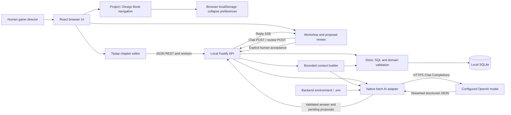
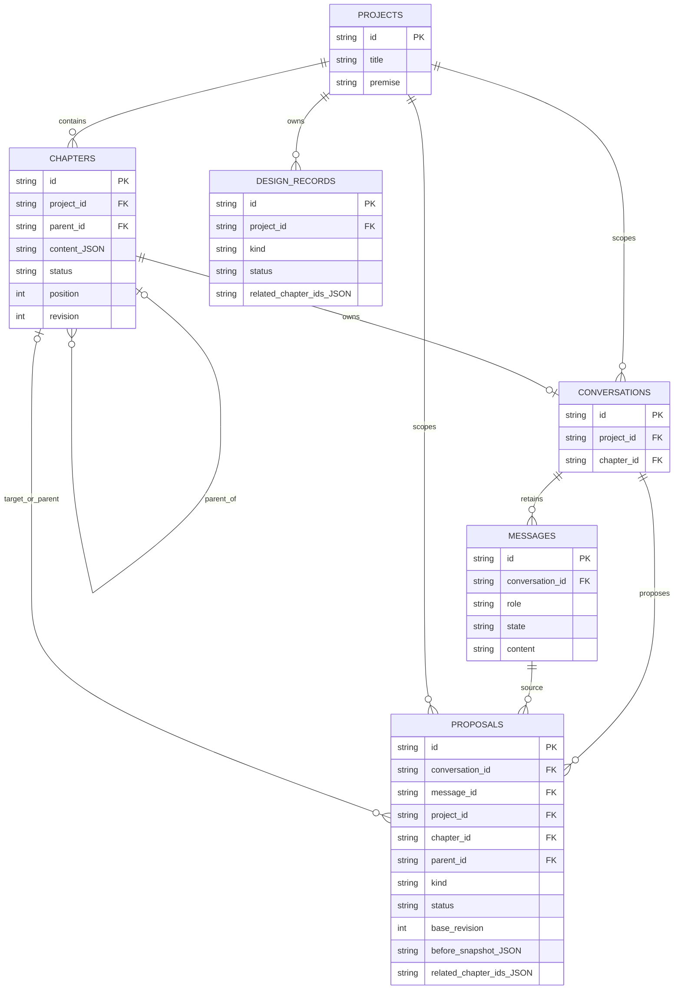

# Forge — Comprehensive Project State Report

Assessment date: **2026-10-11**. Repository: `C:\Users\garne\OneDrive\Documents\ChatGPT\Forge`.

## Scope and evidence conventions

This assessment examines the **current working tree**, including its existing uncommitted and untracked implementation files, rather than only the committed baseline. `package.json` identifies version `0.1.0`. Source files, dependency manifests, migrations, and tests were inspected directly. Documentation was used as secondary context, not as proof of functionality.

- **Verified implementation**: a behavior traced in source. Where an automated test or disposable probe also exercised it, that evidence is stated explicitly.
- **Inference**: an architectural or product implication derived from code; it is not a reproduced production incident.
- **Missing/planned**: absent from the inspected runtime, schema, and interfaces. The supplied vision establishes direction, not an implemented commitment or delivery date.
- **Functional** in the inventory means a coherent implemented workflow with the stated evidence boundary. It does not mean every UI path, external provider, or concurrency condition was exercised.

The assessment changed only this report. It did not open the user's SQLite database, read API credentials, start the application against real data, change configuration, or implement recommendations. Existing tests use in-memory or disposable temporary databases. No new test files were created. File references below are repository-relative with one-based source lines, so another reviewer can locate the evidence; line numbers may shift after later edits.

## 1. Executive summary

Forge currently is a **single-user, local browser application for authoring a hierarchical Game Design Book and discussing it with an AI Workshop**. Users create projects, edit rich-text chapters, move chapters beneath parents, reorder siblings, choose design maturity, and retain per-chapter conversations. The Workshop can produce typed proposals for content, sections, sub-chapters, maturity, decisions, and questions. A separate human review action applies each proposal transactionally.

It is an **early functional foundation**, not yet the full Unity/Codex game development studio described in the vision. Core design workflows have substantial deterministic backend coverage: all **41 existing tests passed** in this assessment. TypeScript checking also passed. Actual OpenAI transport, current credentials, frontend interactions, and production deployment were not exercised in this read-only assessment.

**Functional within the evidence boundary:** project creation/rename; chapter CRUD, hierarchy, ordering and persistence; rich-text autosave implementation; maturity selection; context assembly; mocked AI streaming and proposal generation; atomic approval/rejection; stale-revision protection; decision/question persistence and question resolution; recovery from a reopened database.

**Partial:** project management beyond creation/editing; rich-text fidelity through AI full replacements; visible/controllable context selection; durable continuity beyond recent messages; decision provenance and maintenance; provider connection diagnostics; recovery of unsaved drafts; broad frontend and real-provider verification.

**Missing:** Unity integration, Codex SDK/App Server integration, interconnected game-system entities, assets, code-generation/execution tools, playtesting, production planning, import/export, application-level backup/restore, project archive/delete, persistent chapter revision history, and automated browser tests/CI configuration.

The strongest architectural choices are a simple local deployment, SQLite transactions and foreign keys, shared validation, explicit proposals instead of autonomous mutations, and optimistic concurrency. An injected `DesignAssistant` makes behavior testable without a provider. Main weaknesses are lossy text boundaries, limited lifecycle/provenance modeling, a heuristic context builder, and large UI/store modules with few tests at their integration boundaries.

### Three biggest risks or limitations

1. **Knowledge fidelity and approval semantics.** AI input flattens rich documents, and review displays a text-only comparison. Formatting loss can therefore be invisible in a full replacement. Separately, manual content changes preserve `Approved` maturity unless the user changes it; the next AI request treats that changed text as approved direction. Both are verified code behaviors; the governance consequence is an inference. Sources: `shared/types.ts:186`, `server/ai.ts:113`, `client/components/Workshop.tsx:525`, `server/store.ts:180`.
2. **Incomplete context and continuity.** Only a small selection of chapters and recent conversation excerpts reach the model. Even the current user message is capped to its last 4,000 characters, despite a 20,000-character API input limit. A disposable probe verified that opening instructions disappear. There is no summarization or context inspector. Source: `server/context.ts:43`, `server/app.ts:166`.
3. **Recovery and evidence gaps.** Revision checks prevent overwrites but there is no durable local draft or application undo/history after an accepted change. Decisions can outlive deleted chapter references without preserved provenance. Tests exercise a substitute assistant, not the real provider adapter or browser save/review races. Sources: `client/components/ChapterEditor.tsx:77`, `server/store.ts:225`, `server/store.ts:495`, `tests/forge.test.ts:276`.

## 2. Technology and architecture

### Stack and module boundaries

Versions below are resolved versions in the inspected `package-lock.json`, rather than just the ranges in `package.json`.

| Layer | Technology | Responsibility |
|---|---|---|
| Browser | React/React DOM 19.3.0, TypeScript 5.9.3 | UI and component state |
| Editor | Tiptap React, StarterKit, Placeholder 3.31.4 | ProseMirror-based rich editing and JSON documents |
| Icons/style | lucide-react 0.468.0; handwritten CSS | Visual interface, responsive layout |
| Build/dev | Vite 6.4.4, React plugin 4.7.0 | Browser compilation, local development proxy |
| Backend | Fastify 5.12.5; `@fastify/static` 8.3.0 | REST/SSE API and built frontend serving |
| Validation | Zod 3.25.76 | Request bodies, document checks, AI output checks |
| Database | Node built-in `node:sqlite`, `DatabaseSync` | Local synchronous SQLite, no ORM or separate service |
| Runtime/test | Node >=24 required; tsx 4.23.15; Node test runner | Execute TypeScript server/tests |
| Dev orchestration | concurrently 9.2.5 | Start API and Vite together |
| AI transport | Native `fetch`, AbortController, stream reader | OpenAI HTTPS streaming requests; no AI SDK dependency |

`client/main.tsx:6` mounts `App` under React StrictMode. `client/App.tsx:35` owns projects, selected project/chapter, dialogs, search, save indicators, and review refreshes. `ChapterEditor` encapsulates editing and its save queue; `Workshop` owns chat and proposal review; `DesignBookNav` owns collapse preferences and hierarchy display; `Modal` uses a native `<dialog>`. There is no router, Redux/Zustand, query-cache library, or shared state service.

`server/app.ts:16` contains all routes and the chat lifecycle. `server/store.ts:70` combines SQL access, hierarchy operations, proposal validation/materialization, and review application. `server/context.ts:13` selects design context; `server/ai.ts:92` implements the provider adapter. `shared/` contains types/validation, chapter-tree operations, a limited design-text parser, and a bounded display diff. This is a clear small-app separation, but the store depends on the AI module's change schema, coupling persistence rules to the provider-facing contract.

### Runtime and communication

`npm run dev` runs `node --import tsx --watch server/index.ts` and Vite concurrently. Vite serves `127.0.0.1:5173` and proxies `/api/` to **fixed port 4310** (`vite.config.ts:12`). The API binds `127.0.0.1`, default 4310. Changing backend `PORT` does not automatically change the development proxy.

`npm run build` type-checks and writes browser assets to `dist`; `npm start` runs the TypeScript backend through tsx. Fastify serves `dist` if it exists, with an index fallback for non-API paths (`server/app.ts:277`). There is no separately compiled backend executable, installer, or bundled desktop runtime. Production startup still depends on Node, tsx, server sources, and installed dependencies.

`server/index.ts:8` loads a local `.env` using Node `parseEnv`; those values override inherited environment settings. Database location defaults to `./data/forge.sqlite`, configurable through `FORGE_DB_PATH`. Both database and static paths depend on the process working directory. Startup opens/migrates the database; shutdown closes Fastify and SQLite on SIGINT/SIGTERM.

Normal browser operations use JSON REST requests through `client/api.ts:1`. Chat uses a POST with an SSE response, processed through a Fetch stream rather than `EventSource` (`client/api.ts:17`). Backend events are `user`, `reply`, `error`, and `complete`. The backend makes the external AI request; the browser never receives the API key.



SQLite stores application content. React holds current selections, pending edits, chat stream text, and dialogs in memory. Only navigation collapse preferences use `localStorage` (`DesignBookNav.tsx:13`). A refresh returns to project home; the last project/chapter and unsaved draft are not restored. SQLite recovery should not be confused with restoring all browser session state.

There are **no runtime Git operations, Unity files/bridge, Codex package imports, shell execution tools, asset pipelines, or playtest APIs** in the inspected application. The repository itself is Git-managed; that is not a Forge product integration.

## 3. Feature inventory

| Feature and expected behavior | Actual implementation and status | Evidence and limitations |
|---|---|---|
| Project creation: create a home for a game's design | **Functional.** Optional title/premise; blank title becomes `Untitled game`; one Game Vision chapter is created transactionally | `App.tsx:126`, `app.ts:71`, `store.ts:109`; tested at `forge.test.ts:43`. Premise initially seeds the chapter |
| Project management: update and organize projects | **Partial.** List by updated time and edit title/premise. No archive/delete/duplicate/export | `store.ts:83`, `store.ts:120`. Editing premise deliberately does not sync Game Vision; both can diverge |
| Design Book: ordered, editable chapters | **Functional.** One implicit book per project, add/read/update/delete/reorder chapters | `app.ts:82`, `store.ts:129`; persistence/reorder/deletion tests. No separate book entity or multiple books per project |
| Sub-chapters/navigation: nested structure and collapsible branches | **Functional implementation; UI not exercised in this assessment.** Project → Design Book → chapters; per-project/book/chapter collapse, remembered locally; parent selector; sibling reorder | `DesignBookNav.tsx:47`, `chapter-tree.ts:3`, `store.ts:180`; hierarchy/approval/restart tests in `chapter-tree.test.ts`. Only selected project's children loaded. No arbitrary depth limit; no drag/drop |
| Rich-text authoring and save | **Functional manual path; Partial AI round-trip fidelity.** Tiptap JSON, headings/emphasis/lists/quotes/links, in-editor undo, queued 900ms autosave, manual save and flush | `ChapterEditor.tsx:77`, `:114`, `:150`; backend rich-text persistence tested. No durable unsaved draft, schema is not a complete ProseMirror validator |
| AI/legacy text formatting | **Partial.** Converts headings including `##Gameplay Direction`, bold, inline code, simple lists and fenced code into nodes; normalizes eligible old paragraphs on open | `design-text.ts:27`, `:92`; four parser/persistence tests. Not full Markdown: no general italic/link/table/nested-list parser. Normalization can save merely by opening a chapter |
| Chapter design maturity | **Functional.** Exploring, Proposed, Approved, Needs Revision; manual select or approved status proposal | `types.ts:3`, `ChapterEditor.tsx:326`, `store.ts:553`; status tests. Accepted content becomes Proposed; accepting a proposal is separate from marking its chapter Approved. Manual edits retain chosen maturity |
| AI Workshop conversations | **Functional with injected assistant; live provider unverified.** Contextual chapter conversation, streamed reply, stop, persisted completion/failure state | `Workshop.tsx:78`, `app.ts:157`; `forge.test.ts:276`, `:329`. One concurrent response per project per API process; no resume or automatic retry |
| Context awareness | **Partial.** Project/premise, active chapter, Game Vision, selected approved/draft chapters, hierarchy, records, pending suggestions, recent history | `context.ts:13`; isolation/budget tests. Heuristic selection, character excerpts, no semantic retrieval, no user-visible inclusion list |
| Structured design actions | **Functional in deterministic tests.** Eight kinds: create chapter/subchapter, update, add/revise section, change maturity, record decision/question | `types.ts:139`, `ai.ts:13`, `store.ts:304`; unsupported operations rejected. Non-creation targets restricted to active chapter; max five proposals per reply |
| Proposal review/accept/reject | **Functional backend and implemented UI.** Original snapshot, target/rationale, proposed text/diff, selectable new-chapter destination, stale blocking and regeneration | `Workshop.tsx:133`, `:148`, `store.ts:495`; atomicity, exactly-once and stale-revision tests. Preview/diff flatten formatting; no proposal editing, batch application, or persisted undo |
| Design decisions/open questions | **Partial lifecycle; functional create/resolve persistence.** Acceptance creates approved decision/open question; linked records appear in Workshop; question can be resolved | `store.ts:465`, `:484`, `:536`; `workshop.test.ts:162`, `:426`. No global record UI, revision/supersession, answer text, or source-proposal FK |
| Conversation history/continuity | **Functional storage; Partial model continuity.** One persistent conversation per chapter, all stored messages loaded; only recent complete messages reused | `store.ts:259`, `context.ts:43`; disk reopen tests. No summaries, paging, project-wide conversation, or reuse of another chapter's chat history |
| Search | **Partial.** Case-insensitive title substring search across projects and loaded chapter list | `App.tsx:200`, `:791`. No content search or chapters from all projects |
| AI settings/connection | **Partial.** Instructions for setting backend environment key/model; health reports key presence | `App.tsx:753`, `app.ts:65`. No credential validation or editable settings UI. “Connected” means nonempty configured key, not successful provider authentication |
| Runtime accounts/collaboration | **Missing; UI avatar is a Placeholder.** Single local director, no authentication or user model | `App.tsx:267`. Loopback and origin restrictions support the intended local model, not multi-user access |
| Backup/export/revision recovery | **Missing product workflow.** SQLite persists saved state; README describes manual backup | No application backup/restore/export or revision-history routes/tables. Tiptap undo is editor-session undo |
| Unity, Codex, systems, assets, playtesting | **Missing.** Product direction only | No implementation in inspected source/manifests/schema. System prompt explicitly excludes Unity changes and production plans (`ai.ts:110`) |

## 4. End-to-end workflows

### 4.1 Create a project and open its Design Book

Frontend buttons open `new-project`; `App.submit` flushes an existing editor before posting `{title,premise}` (`App.tsx:126`). `POST /api/projects` validates with `projectInput` (`types.ts:79`), then `Store.createProject` inserts a UUID project and its Game Vision chapter in one transaction. Initial chapter content uses `textDoc(premise)`, not the Markdown converter.

The browser reloads projects and calls `openProject`, which fetches its chapters, sets the project, remounts the editor and selects the first chapter (`App.tsx:98`). Validation errors are shown in the dialog; backend errors use JSON. A creation could succeed before a later fetch fails, so an error is not necessarily proof that nothing was created. `openProject` catches its own fetch failure, which also limits caller knowledge of success. Blank creation and saved recovery are tested; the browser interaction itself was not rerun here.

### 4.2 Create/edit a chapter and persist changes

The Design Book add button opens `new-chapter`, with title and optional parent. Submission posts to the project chapter route. The store validates parent ownership, appends a project-global position, and creates a chapter at revision 0/Exploring (`store.ts:144`). The browser adds it to state and opens it.

The editor maintains a draft ref, dirty flag, revision ref, debounce timer, and serialized promise queue. Title/content/status/parent changes schedule save after 900ms. PATCH supplies the full draft and current revision. SQL increments revision only when the supplied revision matches (`store.ts:180`); mismatch is 409. Parent changes reject self-parenting, descendants, or another project. Successful saves refresh parent React state. Failed saves keep the draft in the editor and offer retry/reload; reload explicitly discards edits.

`flush()` awaits queued saves before navigation/chat/acceptance. `beforeunload` requests a browser warning for unsaved state; it does not persist a draft. Reordering changes positions without chapter revision increments. Deleting a chapter cascades its chat/proposals; direct children move up one level and receive new revisions. Backend tests verify persistence, hierarchy, and conflicts. Browser save-queue races and hard-crash draft recovery remain unverified/missing respectively.

### 4.3 Start an AI conversation and receive a response

Workshop load calls GET `/chapters/:id/workshop`; the store lazily creates that chapter's conversation even though the HTTP operation is GET (`store.ts:259`). Send first flushes the editor, then `chat()` posts content and optional workflow.

The backend rejects a missing configured key (503), invalid content, or another active response in the same project (409). It persists the user message, builds context, attaches an abort handler, sets a 120-second timeout and starts SSE (`app.ts:157`). The provider adapter streams a JSON answer and extracts partial `reply` text. The API forwards reply events. A validated final answer is persisted as a complete assistant message plus pending proposals in a transaction; `complete` reloads Workshop state.

On AI/validation failure, the backend persists a failed/interrupted assistant message, sends an error and final Workshop state, and releases its busy lock. Navigating away or hiding the Workshop unmounts it and aborts the browser request. Saved user messages survive failures. Abrupt process termination does not reconstruct an assistant stream; a user message may remain without a corresponding assistant answer. Existing tests cover substitute-assistant success/failure, not the real HTTP adapter.

### 4.4 Generate a proposed Design Book change

Natural conversation or a workflow starter asks for a concrete change. The model returns `{reply,proposals}` under a strict JSON schema. Zod validates again; `Store.addProposal` checks source conversation/message ownership, complete assistant origin, active target, parent/related chapter ownership, action-specific fields and base snapshot (`store.ts:304`). Section actions materialize a full proposed JSON document against the captured snapshot while preserving other nodes.

A batch is persisted atomically: one invalid proposal rolls back the complete assistant message and every proposal in that batch. The user message and a failed assistant record remain. No chapter/decision content is applied during generation. Tests verify all-or-nothing generation and changes made during generation. A creation proposal has no chapter base revision; nested creations can be accepted independently even after a parent edit.

### 4.5 Review, accept or reject

Clicking a pending card fetches the latest target and opens the comparison dialog (`Workshop.tsx:133`). It displays snapshot/proposal text, rationale, text diff, destination for creations, and stale status. Acceptance flushes manual edits first. Backend review opens a transaction, requires pending state, validates destination and related chapters, and compares target revision (`store.ts:495`).

- Reject updates proposal status only.
- Accept creation makes a new Proposed chapter at the reviewed destination.
- Accept full/section content replaces the target with the materialized proposal, increments revision, and sets Proposed maturity.
- Accept status updates only maturity (and revision/timestamp).
- Accept record creates an approved decision or open question without changing chapter content.

Repeated review and stale acceptance return 409 without overwriting newer content. Accepting one content revision can stale another proposal based on the same revision. Regeneration makes a fresh AI request; it is not a rebase, and does not automatically reject the older pending proposal. After acceptance the UI reloads chapters and remounts the editor (`App.tsx:189`). If this refresh fails after the transaction committed, the error is a refresh failure, not a rollback. Tests verify backend behavior; frontend post-review failure/race paths have no automated coverage.

### 4.6 Reopen and recover state

Startup opens the configured SQLite file, enables foreign keys/WAL, and applies missing migrations. Project home fetches projects/health; opening a project fetches saved chapters; opening its Workshop fetches messages/proposals and chapter-linked records. File-backed tests close/reopen SQLite and verify rich documents, chapter order/hierarchy/maturity, conversation IDs, messages, proposals/snapshots and records.

This verifies **saved-data recovery**, not automatic last-session restoration. Selected project/chapter, composer text, current stream, and unsaved editor draft are memory-only. Browser-local collapse settings persist per browser origin. Data-file corruption recovery, real backup restore, crash during migration, and production restart were not tested.

## 5. AI Workshop deep dive

### Exact integration mechanism

This is an integrated design assistant, not just chat: answers can generate persistent, validated domain proposals that the human applies through a different endpoint. However, the model has **no executable tools** and no direct data mutation capability.

The actual transport is native `fetch("https://api.openai.com/v1/chat/completions", ...)` with bearer `OPENAI_API_KEY`, `stream: true`, and `response_format.type = "json_schema"` (`ai.ts:97`). Model is `OPENAI_MODEL || "gpt-4.1-mini"`; the report did not inspect private environment values to determine the user's override. There is **no OpenAI SDK, Codex SDK, Codex App Server, Responses API, Agents SDK, MCP execution, or CLI integration** in the application.

One system message contains behavioral instructions, workflow mode, and serialized context. Completed history follows as user/assistant messages. Structured output requires a reply and proposal list, each proposal carrying action, target/parent, title/content, description/reason, optional section/status, and related chapter IDs. Zod adds maximum lengths, enum/UUID checks, strict rejection of extra fields, and five-proposal limit. The store adds semantic checks. API-schema enforcement alone is not the safety boundary.

The custom stream reader consumes OpenAI `data:` lines, accumulates raw JSON, extracts the reply field for display, requires `finish_reason === "stop"`, rejects refusal/oversized output, and parses the final object. It handles 401/429 with useful messages. The local API bounds the request at 120 seconds; accumulated response JSON is capped at 600,000 characters. No token-output cap, usage/cost recording, retries/backoff, model-capability check, or provider connectivity test exists.

### Actual context selection

`buildContext` gets only the active project. Chapter and record text share a **32,000-character** pool; history has a separate **8,000-character** pool. These are character bounds, not tokenizer/model-context guarantees. IDs, metadata, titles, serialization and system instructions add overhead.

| Context element | Selection/budget |
|---|---|
| Project | Title/metadata; premise capped at 4,000 characters |
| Active chapter | First 10,000 plain-text characters with maturity |
| Game Vision | First exact case-insensitive title match; up to 5,000 characters; omitted as separate item when active |
| Ancestors/children | Last eight ancestor descriptors; first 20 direct-child descriptors; ancestor candidates receive high relevance score |
| Approved chapters | Up to four candidates, 2,500 characters each |
| Other relevant chapters | Up to three positive-scoring non-approved candidates, 2,000 characters each |
| Records | Up to 12 non-resolved records, active-linked first; text up to 1,200 and rationale up to 500 characters within remaining pool |
| Pending suggestions | Last five pending proposals in this chapter conversation; kind/title and up to 300 rationale characters, not full proposed content |
| History | Up to 20 completed messages in the same conversation; newest first for budget allocation, then restored chronology; last 4,000 characters per message, total 8,000 |

Relevance uses repeated English alphabetic words of length >=4 from the active title and last three retained messages, matched against chapter title and first 5,000 characters. It is not embeddings, a design graph, or semantic retrieval. Approved candidates compete for a four-item limit; approved decisions can be omitted or clipped when the pool is exhausted. No full book outline/section-heading index is supplied. Renaming Game Vision breaks its special title-based lookup. No durable role identifies that chapter.

The model is told to respect approved chapters/decisions, treat drafts and pending ideas differently, ask focused questions, and never treat supplied content as instructions. This is useful prompting, but source content is still embedded inside the system message; prompt-injection resistance is not empirically tested. The stronger boundary is that only allowlisted proposals can be stored and only explicit review can apply them.

`activeTruncated` blocks full replacements of active chapters longer than 10,000 plain-text characters (`app.ts:218`). Section operations remain allowed and apply against the full snapshot, protecting unrelated content. The model may nevertheless have no view of a requested later section; clipping has no offset/section retrieval mechanism. Truncation flags are available to the model, not surfaced as a user context inspector.

All messages persist, but only recent complete excerpts return to the model. Failed/interrupted messages remain visible and are excluded from model history. Other chapters' conversations are not shared. No summarizer, retrieval of older messages, contradiction detector, or long-term memory beyond selected chapter text and records exists. “Challenge” and “gaps” are prompt modes, not separate analyzers.

## 6. Data model and relationships

`server/db.ts:5` uses foreign keys, WAL, and a 5-second busy timeout. UUID identifiers come from Node `randomUUID`. Each migration runs in a `BEGIN IMMEDIATE` transaction and records an integer version.

| Table | Important columns and constraints |
|---|---|
| `migrations` | Integer PK `version`, `applied_at`; versions 1–3 |
| `projects` | UUID-text PK, title, premise, created/updated timestamps |
| `chapters` | PK, project FK, optional parent chapter FK, JSON-text content, title, maturity CHECK, position, revision, updated timestamp |
| `conversations` | PK, project FK, chapter FK with UNIQUE: one per chapter |
| `messages` | PK, conversation FK, user/assistant role CHECK, content, state, created timestamp |
| `proposals` | PK, conversation/source-message/project FKs; optional target/parent chapter FKs; JSON content/snapshot/related IDs; kind, section, status proposal, base revision, pending/accepted/rejected CHECK, description/reason/title/timestamp |
| `design_records` | PK, project FK; decision/question CHECK; text/rationale; JSON related IDs; approved/open/resolved CHECK; timestamp |

Migration 1 creates projects, flat chapters, conversations, messages, proposals. Migration 2 adds typed actions/snapshots/related IDs and records; legacy targetless proposals become create actions, and snapshots are backfilled only when chapter revision still matches. Migration 3 adds chapter and proposal parent IDs and a parent-order index. Tests exercise selected legacy upgrades, not every historical or corrupted database variant.



`related_chapter_ids` are JSON references, **not relational foreign keys**, so the diagram deliberately omits an enforced Chapter–Record edge. Source/target/parent relationships in proposals are distinct columns despite the compact diagram's combined edge.

Integrity and future constraints:

- Project ownership is duplicated across chapter, conversation and proposal for convenient scoping. Ordinary foreign keys do not prove these IDs belong to the same project; store validation does. Parent cycles and cross-project parents are also prevented in application logic, not SQL CHECKs/triggers.
- JSON content is parsed into trusted TypeScript interfaces without revalidating database rows. SQL has no JSON-validity constraints. Proposal kind/status combinations and message state are not fully constrained by the database.
- Deleting chapters cascades their conversation/messages/proposals. Store code promotes surviving children before deletion; raw SQL deletion would instead use `ON DELETE SET NULL`. Proposal parent FK deletion also cascades, so a creation proposal placed under a deleted chapter can disappear even if its source conversation survives.
- Decision/question chapter links survive deletion as dangling JSON IDs. The records remain project-owned and can still enter AI context but disappear from normal chapter-linked UI. This was reproduced. Acceptance revalidates related IDs; a pending proposal mentioning a deleted related chapter fails review until rejected/regenerated.
- Accepted creations do not store their resulting chapter ID; accepted records do not store source proposal/message/conversation IDs. There is no `reviewed_at`, reviewer, applied-result ID, question answer, decision supersession, or durable chapter-revision table. Historical audit and rollback are therefore limited.
- One implicit Design Book per project and one conversation per chapter are sensible initial constraints. Multiple books, project-wide chat, cross-project reuse, and interconnected systems would require explicit product/model decisions.
- Ordering uses one project-global numeric position, interpreted as sibling order by the tree helper. There is no unique position constraint. Hierarchy traversal assumes valid rooted data; `chapterOutline` has no cycle/depth guard, unlike `isDescendant`.
- Proposals store full proposed documents and often full original snapshots, including section changes. Storage can grow substantially; conversations/proposals/records have no pagination or retention policy.

## 7. Code quality and technical debt

### Strengths to preserve

Strict TypeScript spans client/server/shared/tests. Zod validates input and model output; prepared SQL avoids interpolation of user values. Atomic proposal batches and transactional review preserve the human approval boundary. Chapter revisions prevent lost updates from conflicting saves and stale proposals. Parent/project checks and context filtering are tested. Credential handling stays backend-only: `.env` is ignored, no Vite key injection or API credential response exists. Manual design work does not require AI access.

SQLite and direct Fetch suit this small local app; an ORM, microservices, or agent framework are not required to solve the current issues. The injected assistant is an effective test seam. Domain maturity is distinct from Unity implementation and proposal acceptance.

### Concrete issues and impact

| Issue | Evidence | Impact and certainty |
|---|---|---|
| Latest input loses its opening | `context.ts:55`; API allows 20,000 characters (`app.ts:166`) | **Reproduced:** >4,000-character input retains suffix only. A user can submit instructions the AI never sees |
| Rich documents become plain text in context and review | `types.ts:186`, `ai.ts:113`, `Workshop.tsx:525` | **Verified:** headings, marks, link URLs, list structure and some breaks are flattened. Full replacements may lose formatting invisibly; section edits preserve outside nodes |
| Manual changes remain Approved | `store.ts:180`, editor draft/save path | **Reproduced:** content changed after approval, maturity stayed Approved. Whether approval should apply to a chapter or exact revision is unresolved product semantics |
| Record references/provenance incomplete | `db.ts:37`, `store.ts:225`, `:536` | **Reproduced:** approved record survives with deleted chapter ID. No source linkage or amendment history; model can retain evidence users cannot easily inspect |
| Document validator is looser than editor schema | `types.ts:10`, `:68` | **Reproduced:** a root-level text node passes validation despite a ProseMirror document expecting block children. Node attributes/parent-child grammar and mark placement are incompletely validated; browser round-trip consequence not tested |
| Legacy normalization changes data on view | `ChapterEditor.tsx:61`, `:140`; `design-text.ts:92` | **Verified:** eligible Markdown-like paragraphs are normalized then autosaved. Literal prose can be reinterpreted, and an Approved chapter's revision can change without deliberate editing |
| Busy lock cleanup does not cover request setup | `app.ts:179–190`, try starts later | **Inference from control flow:** failure in addMessage/buildContext after locking can leave the project busy until process restart. Normal provider errors do release it |
| No durable draft or accepted-change undo | `ChapterEditor.tsx:59`, `:158`; schema | **Verified missing:** crashes before save can lose work; revision conflict offers reload/discard rather than merge. Snapshots are proposal-specific, not universal revision history |
| Broad UI/store responsibilities and weak boundary typing | `App.tsx:35`, `Workshop.tsx:28`, `store.ts:70`; `api.ts:22`, `store.ts:29` | Large modules combine concerns. API generics are unchecked assertions, SSE data and DB rows use `any`; compile success is not end-to-end response validation |
| Expensive/unbounded reads | `store.ts:83`, `:99`, `:259`, `context.ts:98` | Each project lookup loads all projects/counts; context reads all chapters and records; Workshop loads all history/proposals. Synchronous DB and repeated relevance scoring are acceptable small-scale but not measured at large scale |
| Minimal diagnostics | `app.ts:24`, `index.ts:17` | Logger disabled; generic 500s omit internal evidence, startup DB/env failures occur before listen catch. No persistent request/provider diagnostics or cost metrics |
| Chat/review rendering remains plain text | `Workshop.tsx:301`, `:517`; CSS pre-wrap | React safely escapes text, but AI reply Markdown markers are displayed literally. Document formatting fix does not add rich chat or review rendering |

Security scope: the backend binds loopback and rejects foreign Host/Origin values (`app.ts:28`); tests exercise these protections. The application has no authentication, local-session token or account model. Local processes and allowed loopback clients are trusted; these protections should not be described as multi-user isolation. Opening the server to a network would materially change its threat model. No live credential exposure test, security audit, dependency vulnerability scan, or adversarial prompt test was performed. Configured AI requests transmit selected design material to OpenAI; local storage does not mean offline AI.

Test coverage is strong for transactional rules, persistence and validation, but no numerical coverage percentage was collected. There are no browser test dependencies/files, lint script/config, or CI files in the inspected inventory. Existing tests do not invoke `openAIAssistant` over mocked HTTP: API chat tests replace the entire assistant. Refusal, transport framing, timeout/client-disconnect wiring, busy-lock recovery and UI autosave/refresh races deserve targeted coverage.

## 8. Verification

### Commands and results

Commands ran from the repository root in PowerShell. Besides source reads and inventory searches, these checks were executed:

```powershell
npm run check
& 'C:\Users\garne\.cache\codex-runtimes\codex-primary-runtime\dependencies\node\bin\node.exe' --import tsx --test --test-isolation=none tests/*.test.ts
node --version
& 'C:\Users\garne\.cache\codex-runtimes\codex-primary-runtime\dependencies\node\bin\node.exe' --version
node -e 'const p=require("./package-lock.json"); for (const n of ["react","react-dom","@tiptap/react","@tiptap/starter-kit","@tiptap/extension-placeholder","fastify","@fastify/static","zod","lucide-react","typescript","vite","tsx","concurrently","@vitejs/plugin-react"]) console.log(n+" "+p.packages["node_modules/"+n].version)'
```

| Check | Result |
|---|---|
| `npm run check` (`tsc --noEmit`) | **Passed**, exit 0; no emitted application files |
| Existing test suite using explicit Node 24 path | **Passed: 41 tests, 0 failures/skips/cancellations**, exit 0 |
| Default `node --version` | v22.18.0, below declared supported server runtime |
| Explicit bundled Node version | v24.19.0; used for tests and probes |
| Lockfile version inspection | Passed; resolved versions documented above |
| Disposable in-memory behavior probe below | Passed; reproduced all five observations |

Test distribution: 15 in `forge.test.ts`, 13 in `workshop.test.ts`, 9 in `chapter-tree.test.ts`, 4 in `design-text.test.ts`. Evidence includes file-backed close/reopen tests, selected migration tests, API injection tests, context isolation/budgets, failed/interrupted substitute responses, immutable rejection, exact-once acceptance, stale protection, section preservation, nested creation and safe reparenting.

`npm test` was not invoked under the unsupported default Node 22. Instead, its exact underlying test runner arguments were executed with Node 24. All existing tests ran. There is no lint command to execute. `npm run build` was deliberately **not rerun**, because Vite writes/clears `dist` and this request permits only report changes. Earlier build results are not used as current-assessment verification. No dependency install/update or network request was made.

### Exact disposable probe command

This command created only an in-memory database; it did not use `server/index.ts`, load `.env`, or touch project data:

```powershell
@'
import {openDatabase} from './server/db.ts';
import {Store} from './server/store.ts';
import {buildContext} from './server/context.ts';
import {textDoc,docText,docSchema} from './shared/types.ts';
const db=openDatabase(':memory:');const s=new Store(db);const p=s.createProject('Assessment fixture','');const c=s.chapters(p.id)[0];
s.updateChapter(c.id,{revision:0,status:'Approved'});s.updateChapter(c.id,{revision:1,content:textDoc('Unreviewed manual change')});console.log('Manual edited maturity:',s.chapter(c.id).status);
const w=s.workshop(c.id);const m=s.addMessage(w.conversationId,'assistant','A proposed decision');const r=s.addProposal(w.conversationId,m.id,p.id,{kind:'record_decision',chapterId:c.id,title:'Decision',content:'Cooperative game',reason:'Shared goals'},2);s.reviewProposal(r.id,'accept');s.deleteChapter(c.id);console.log('Record after linked chapter deletion:',JSON.stringify(s.records(p.id).map(r=>({status:r.status,linkedChapterStillExists:!!db.prepare('SELECT id FROM chapters WHERE id=?').get(r.relatedChapterIds[0])}))));
const active=s.createChapter(p.id,'Gameplay');const aw=s.workshop(active.id);const user=s.addMessage(aw.conversationId,'user','IMPORTANT OPENING REQUIREMENT '+ 'x'.repeat(5000)+' FINAL NOTE');const ctx=buildContext(s,active.id,[user]);console.log('Prompt sent length:',ctx.messages[0].content.length,'Opening retained:',ctx.messages[0].content.includes('IMPORTANT OPENING REQUIREMENT'),'Ending retained:',ctx.messages[0].content.includes('FINAL NOTE'));
console.log('Structurally invalid root text accepted by docSchema:',docSchema.safeParse({type:'doc',content:[{type:'text',text:'Root inline node'}]}).success);
console.log('Heading and bold flatten:',docText({type:'doc',content:[{type:'heading',attrs:{level:2},content:[{type:'text',text:'Loop'}]},{type:'paragraph',content:[{type:'text',text:'Salvage',marks:[{type:'bold'}]}]}]}));
db.close();
'@ | & 'C:\Users\garne\.cache\codex-runtimes\codex-primary-runtime\dependencies\node\bin\node.exe' --import tsx --input-type=module
```

Observed output: edited maturity `Approved`; retained record with `linkedChapterStillExists:false`; context prompt length 4,000 with opening absent and ending present; root text accepted `true`; heading/bold document flattened to `Loop` and `Salvage` plain text.

### Remaining unverified

Real provider authentication, compatibility of the configured model with structured outputs, SSE/refusal behavior, latency/cost/design quality; actual browser editing/review/hierarchy interactions in this assessment; multi-tab races; provider timeout and physical client disconnect; abrupt crash/migration recovery; corrupted data, backup restoration and large-book performance; deployment packaging and accessibility across devices. These are evidence gaps, not claims that each workflow is broken.

## 9. Alignment with Forge's vision

**Well aligned:** browser-based local design ownership; Design Book as persistent knowledge; conversations producing reviewable design changes; explicit director approval; maturity labels separating exploration from authority; preserved conversations and bounded project-isolated context. Project → Design Book → chapters also leaves a natural location for future project features without inventing separate books prematurely.

**Incomplete relative to the vision:** “built around Unity and Codex” is not implemented. Current AI is OpenAI model inference through Chat Completions. There is no Unity project path/identity, workspace trust model, code/asset links, change sandbox, build/test runner, tool permissions, or playtest evidence model. These foundational capabilities will matter later, but should not be added before stabilizing design knowledge and approval.

**Potential misalignment:** full replacements and plain-text previews can undermine a trusted Design Book. Approved status is attached to mutable chapters, not an immutable reviewed revision. Chapter deletion removes conversation evidence while linked decisions can remain authoritative. The system prompt's ban on coding/Unity is appropriate for today's feature scope but must become an explicit capability boundary if development tools are introduced.

**Unnecessarily complicated or premature areas:** the handwritten partial JSON/SSE decoder, Markdown subset and plain-text diff create multiple representations that need coordinated fidelity rules. Duplicated provider JSON schema, Zod schema and store semantics can drift. Section proposals duplicate full documents despite being narrow actions. These are bounded implementation costs, not justification for a framework rewrite. A database service, agent orchestration platform, or large state-management system would be premature without evidence that this small architecture cannot support the next priorities.

**Preserve before expansion:** stable IDs and migrations; source-linked pending proposals; transactional approval/rejection; snapshots and stale checks; same-project restrictions; human maturity choices; per-chapter conversation persistence; manual operation without credentials; backend-only credentials; loopback deployment; injected assistant tests. Any Codex/Unity integration should extend these approval and evidence principles rather than bypass them.

## 10. Recommended next steps

These are recommendations only; none were implemented during the assessment. Strengthen Design Book/Workshop first.

| Priority | Recommendation and why | Dependencies | Complexity | Timing |
|---|---|---|---|---|
| 1 | Preserve the complete current user message and make omitted context visible. Separate latest input from clipped history; show selected chapters, records and truncation so the director can assess the answer | Context contract and UI disclosure; tests for long prompts/budgets | Medium | Immediate |
| 2 | Establish faithful document serialization and review. Preserve heading identity/links/structure in AI input; render proposal content accurately and make formatting changes visible; tighten editor-compatible validation | Agree on canonical document and supported AI interchange format | Medium | Immediate |
| 3 | Define approval semantics for manual edits and normalization. Decide whether Approved applies to a revision; clarify acceptance versus maturity; avoid silent reinterpretation of literal text | Product decision plus save/maturity tests | Medium | Immediate |
| 4 | Add focused browser and provider-adapter tests. Cover edit→save→chat→review→reload, conflict/refresh races, SSE framing/refusal, disconnect/timeout, lock release | Disposable fixture server/data; transport seam or fetch mock | Medium | Immediate |
| 5 | Complete record lifecycle/provenance. Store originating/applied proposal links and reviewed timestamps/results; make project-wide records inspectable; define deletion and supersession behavior | Additive migrations, record maintenance UX | Medium | Immediate, before records become major authority |
| 6 | Strengthen recovery. Persist local drafts safely, add durable chapter history/restore, and expose tested export/backup/restore; distinguish committed action from refresh failure | Snapshot/revision strategy; safe recovery UX | High | Begin near term; deliver incrementally |
| 7 | Improve continuity and contextual retrieval. Add section-aware excerpts/heading indexes, durable Game Vision identity, and reviewed summaries or retrieval of older evidence. Measure relevance before adopting embeddings | Priorities 1–3; explicit authority/provenance rules | Medium | Near term after immediate correctness work |
| 8 | Improve runtime diagnostics and supportability. Ensure request setup releases locks, add redacted diagnostics/provider usage, validate connection state, reconcile dev PORT behavior and supported Node startup | Error taxonomy and credential-redaction policy | Low–Medium (overall Medium) | Near term |
| 9 | Refactor only at established seams and measure scale. Separate proposal domain schema from provider adapter, extract UI controllers, add paging/query optimization where fixtures demonstrate need | Coverage from priority 4; benchmark target book/history sizes | Medium | Defer broad refactoring; targeted changes with evidence |
| 10 | Define the Unity/Codex bridge contract before implementation. Decide project paths, read/write permissions, proposed code changes, isolation, validation and execution evidence | Stable design context, provenance, recovery and approval workflows | High | Defer automation; architectural discussion may proceed |

## Questions for Independent Review

1. Should chapter approval apply to a specific revision, and what should happen when the director edits an Approved chapter or legacy normalization changes it?
2. What is the canonical design representation, and should AI editing use document operations, Markdown serialization, section patches, or complete JSON documents?
3. Should the current user message always be included verbatim, and how should the director see/control context omissions and record authority?
4. Is chapter-scoped conversation the right primary model, or should project-level discussion and cross-chapter history retrieval coexist with it?
5. What evidence must a decision retain, and how should deletion, supersession, answered questions and contradictory choices affect AI authority?
6. Does proposal acceptance need a persistent applied-result/revision link, and should multiple proposals be approved atomically or individually with explicit dependency handling?
7. Which recovery guarantee is required for a local studio: durable drafts, revision restoration, export, integrated backup, or all four—and in what order?
8. Should Forge continue using direct OpenAI inference for design while adopting Codex separately for execution, or should an alternative integration replace it? What product benefits justify that change?
9. What should the local trust boundary be before tools can access Unity projects, Git worktrees, shells or assets, and which actions must remain reviewable proposals?
10. What minimum browser/provider tests and knowledge-fidelity criteria must pass before expanding beyond Design Book and Workshop?
