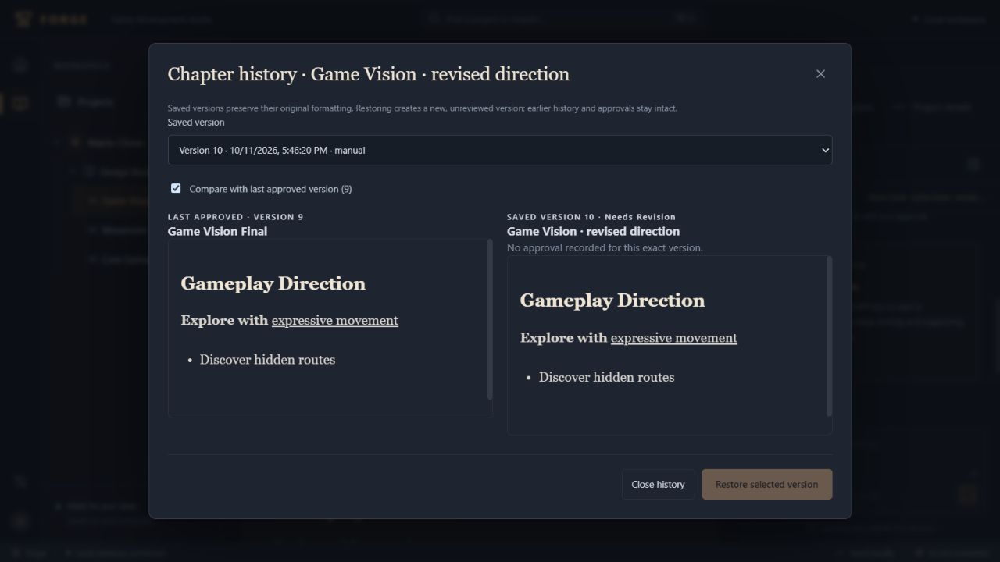

# Goal 3 — Milestone 1: Document History and Approval Foundation

Date: 2026-10-11. This milestone is the authorized review gate; the remainder of Goal 3 is not complete.

## Implemented

- Additive SQLite migration 4 preserves existing chapters, content, IDs, revision numbers, conversations, proposals, and decisions. Each current chapter receives one available baseline snapshot. Existing Approved labels become migration-origin approvals; unavailable earlier history is not invented.
- `chapter_revisions` and `chapter_approvals` retain immutable snapshots/evidence. SQL triggers reject history/approval update and deletion. Composite foreign keys enforce chapter/project ownership for revision rows.
- Chapter creation, saves, proposal application, restoration, archive, and return append snapshots within the enclosing transaction. Stored origins distinguish migration, creation, manual edits, proposals, restoration, archive, reparenting and return. Proposal-origin snapshots/approvals reference the actual accepted proposal.
- Approval refers to an exact saved revision. The browser uses an explicit **Approve current version** action. Title/document changes, including formatting and links, become unreviewed and retain earlier approved content. Canonical comparison ignores JSON object key order, but preserves node/mark order and attributes. Placement and ordering alone do not invalidate content approval.
- **History** displays original rich JSON and approval/source information, offers comparison against the latest approved snapshot, and restores earlier title/content as a new unreviewed revision. The chapter's current parent is retained; restoring a document does not rewind the book hierarchy or approval state.
- Chapter removal now archives instead of cascading deletion. It retains history, approvals, conversations, proposals and decisions; live children move up one level. Archived chapters are omitted from the live book, counts, search and AI chapter context. Their history can be inspected and they can be returned to the book. Returning a parent does not undo later child placement changes.
- Current chapter writes, restores, creation under archived parents and proposal acceptance from archived source conversations are blocked. Historical reads and rejection remain available. Archive/return/restore/approval actions require optimistic revision checks.
- Approved AI chapter context reads the saved approved document separately from any changed draft. Explicit decisions are not revoked when their source is edited or archived.
- Chapters with prior approvals are no longer automatically reparsed as Markdown on editor load. History views never normalize or save content. Unapproved legacy paragraphs retain the existing formatting repair behavior with a preexisting history snapshot.

## Architecture and compatibility notes

React, Tiptap, Fastify, SQLite, and the existing provider/proposal infrastructure remain in place. No knowledge entities, grouped proposal UI, background extraction, agent framework or Unity features were added.

There is no broad architectural deviation. A separate immutable approval table records approval events rather than mutating snapshots. Internal Store transactions compose within an outer creation/review transaction. The existing DELETE chapter route is retained for compatibility but now requires a revision body and performs archival; the UI names the action correctly.

The older regression assertions expecting destructive deletion were updated to require preserved evidence and an archived-source rejection. All other regression scenarios remain covered.

## Automated verification

```powershell
npm run check
& 'C:\Users\garne\.cache\codex-runtimes\codex-primary-runtime\dependencies\node\bin\node.exe' --import tsx --test --test-isolation=none tests/*.test.ts
npm run build
```

Node v24.19.0 was used for runtime tests because the shell default is Node 22. The suite comprises 53 tests, including 12 new history/approval tests. Type checking, all tests, and the production build passed. Vite retains its existing bundle-size warning.

New tests cover exact approvals and material changes; rich JSON restoration; immutable history; stale approval/restore rejection; proposal-origin evidence; source archival and child preservation; archived write protection and return; approved/draft context separation; restart persistence; actual pre-history schema migration and repeatability; API validation; transaction rollback on snapshot failure; and database project ownership constraints.

Tests use in-memory or temporary disposable SQLite fixtures, including a pre-migration database. No production data was used for verification.

## Browser verification

A disposable in-memory fixture served the built UI at a separate loopback port. Browser interactions verified:

1. Editing an approved title immediately displays changed/unreviewed content, and saving changes maturity to Needs Revision.
2. History retains the prior approval and renders headings, bold text, links, and lists in read-only comparisons.
3. Selecting an older snapshot restores its title and rich document into a new unapproved version.
4. Explicit approval finishes with saved state and records the new approved version without extra editor-generated saves.
5. Archiving a parent removes it from navigation and promotes its child; Archived chapters exposes the preserved versions; returning the chapter restores it to the live book.
6. Reloading the browser recovers saved chapter state. Browser warning/error logs were empty.



## Unverified or intentionally deferred

- Migration on the user's actual database was not separately rehearsed; migration safety was verified with disposable legacy fixtures. Startup applies migration 4 when the updated backend next opens a database lacking it.
- No live OpenAI request was made. Proposal integration tests inject a deterministic assistant; provider transport/quality is unchanged.
- Full AI document-contract fidelity, structural proposal diffs, complete current-message handling and context manifests belong to later milestones. This milestone preserves history/restore JSON; it does not claim to repair the existing lossy AI text interchange.
- Concepts, project-level Design Knowledge, normalized record links/provenance, immutable decision supersession, question answers, exploratory-versus-authoritative knowledge acceptance, and grouped dependent acceptance remain future Goal 3 work.
- No durable browser draft recovery, database corruption recovery, backup product workflow, history pagination/retention, or automated browser test suite was introduced. Browser verification above was performed through actual UI interactions.

Work stops here for milestone review before knowledge persistence begins.
