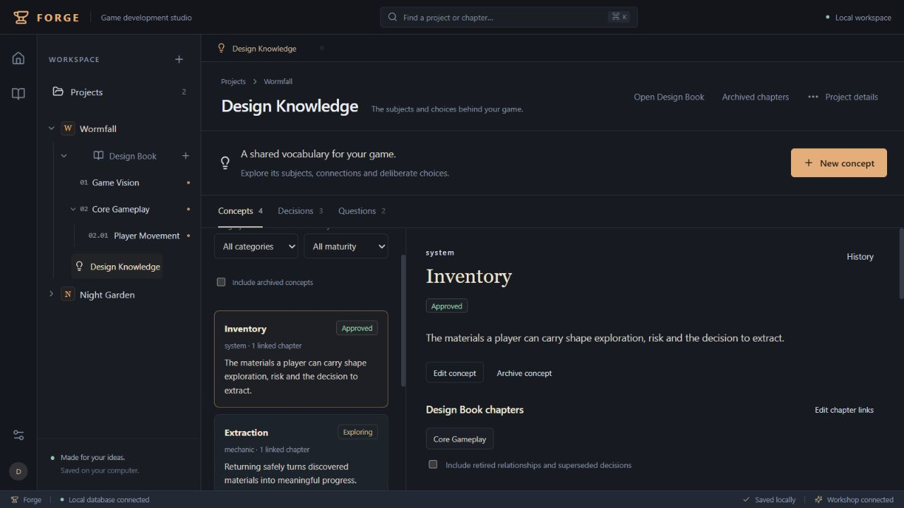
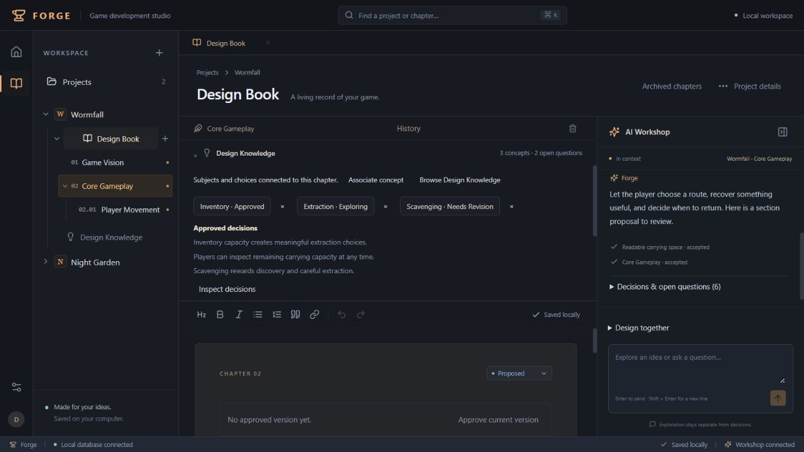

# Goal 3 — Milestone 3: Design Knowledge Interface

Date: 2026-10-11. Scope: the human-facing knowledge workspace, chapter integration, and verification. Milestone 3 stops here for review. AI knowledge extraction and new AI proposal actions were not implemented.

## 1. Implemented UI functionality

Design Knowledge is a feature beneath its owning project, alongside Design Book. Existing project/book/sub-chapter collapse controls remain available. The dark Forge shell and writing/Workshop layout are retained.

- Browse active concepts; search normalized names; filter category and maturity; optionally include archived concepts. Empty states explain creation and explicit approval.
- Create Exploring concepts, edit name/category/description/maturity, approve explicitly, archive, and return as unreviewed. Returning can supply a replacement name when another active concept has reused it. Detail shows dates, version, chapters, relationships, decisions, questions, sources and history. New changes to approved concepts display Needs Revision with access to the exact previously approved snapshot.
- Create typed relationships with existing concepts and a rationale; edit, approve, retire, inspect history, and navigate to either endpoint. Human-readable predicates distinguish incoming/outgoing directed relationships from shared symmetric relationships. Backend duplicate, ownership and revision validation remains authoritative.
- Browse current decisions and historical superseded statements. Manual creation explicitly records an approved choice. Supersession creates a replacement with the previous statement/rationale retained. Inspect associations, sources, and history.
- Create questions, record resolution answers, reopen, and inspect prior answers. Resolved questions remain accessible and are visually distinct from authoritative decisions.
- A collapsed chapter disclosure expands to associated concepts, relevant approved decisions, open questions and active relationships. Associate/disassociate concepts with confirmation; navigate chapter → concept → linked chapter. Archived chapter links open their retained history.
- Evidence views use readable source labels and availability states, exact read-only historical chapter JSON, original Workshop messages, accepted proposal metadata, and immutable snapshots. Historical association labels identify current names rather than pretending the names themselves are historical snapshots. Raw database IDs are not displayed.
- Forms explain saving, preserve drafts after rejected writes, and provide explicit discard/reload recovery. Submission is guarded against duplication. A successful write followed by a failed refresh closes the submitted form and reports that the change was saved, offering reload rather than encouraging a duplicate write.





## 2. New and modified components

| File | Responsibility |
| --- | --- |
| `client/knowledge.ts` | Existing API reads/mutations, transient project-scoped state, late-response guards, reload/error handling, readable labels |
| `client/components/knowledge/KnowledgeWorkspace.tsx` | Concepts/decisions/questions workspace, search/filter controls, selection and empty states |
| `KnowledgeConcept.tsx` | Concept forms, lifecycle actions, approval snapshot, associated details |
| `KnowledgeRelationships.tsx` | Typed connection creation/editing, approval/retirement, direction and navigation |
| `KnowledgeRecords.tsx` | Existing decision/question lifecycle and associations |
| `KnowledgeEvidence.tsx` | Provenance, exact source inspection, immutable history |
| `KnowledgeForms.tsx` | Shared forms, reference pickers, save guards and status labels |
| `ChapterKnowledge.tsx` | Compact chapter context and association operations |
| `client/App.tsx`, `DesignBookNav.tsx` | Feature navigation, editor flush, chapter navigation, project-change guards and selected feature |
| `client/components/Modal.tsx` | Unique accessible title IDs for nested dialogs; controlled cancellation during saves |
| `client/style.css` | Workspace, cards, forms, evidence, responsive layouts and compact disclosure styling |
| `tests/knowledge-ui.test.ts` | Six frontend/integration tests using real React components and Fastify/SQLite operations |

Component filenames without a directory above are under `client/components/knowledge/`. The same SQLite/domain operations from Milestone 2 remain the sole durable knowledge store. No duplicated decision/question model or background synchronization was introduced.

## 3. API changes

One additive read-only route: `GET /api/projects/:projectId/knowledge/sources/:id`.

`KnowledgeStore.sourceDetail` resolves a validated, project-owned source into readable chapter metadata, its exact saved chapter revision when cited, its original Workshop message when cited, and accepted proposal title/kind/status/reason. `shared/knowledge.ts` adds the response type. A foreign project's source ID returns 404. Existing provenance constraints determine valid sources; the endpoint creates no evidence and modifies no entity.

All mutations reuse existing Milestone 2 endpoints with expected revisions. No schema or migration changes, new AI operation types, or provider integration changes were required.

## 4. Browser verification

Actual browser verification used a disposable SQLite database and a separate Fastify production-build server on loopback port 4311. The preview bootstrap did not load `.env`, real project data, or API credentials. A deterministic assistant exercised the existing Workshop pipeline; no live provider call was made. Preview bootstrap/database/sidecars were removed after verification.

Verified through UI interactions:

1. Project → Design Knowledge navigation; concept creation, search, category/maturity filters and detail selection.
2. Scavenging creation, explicit approval, editing to Needs Revision, inspection of its previous approved description, archival and unreviewed return.
3. Symmetric Scavenging/Extraction connection with rationale, explicit approval, retirement, and retained historical display. Inventory's existing directed relationship showed its direction and reviewed state.
4. Chapter association/disassociation and navigation in both directions; compact context included relevant concepts, approved decisions, open questions, and reviewed relationships.
5. Manual decision creation and explicit supersession; original statement remained visible as historical with its replacement identified.
6. Question creation, resolution with an answer, reopening, and inspection of the retained earlier answer.
7. Exact historical chapter source inspection and original accepted-proposal/Workshop evidence. After editing the cited chapter, its version-0 source was marked historical while still displaying original content.
8. Two-window conflict: the second window saved a concept edit; the first window's stale submission was rejected while preserving its draft. Explicit discard/reload showed the second window's saved content.
9. Switching to Night Garden displayed only its Seasonal Growth concept, excluding Wormfall's knowledge.
10. Existing chapter editing/saving and Workshop conversation → section proposal → review → acceptance. The editor reflected the accepted heading and bold formatting, and retained unrelated chapter prose.
11. Stopped and restarted the server against the same disposable database, opened a fresh browser tab, and recovered Scavenging's second-window description and last approval, its retired relationship, superseded/current decision pair, reopened question, chapter association, edited chapter and accepted Workshop proposals/conversation. This checks actual process/database recovery, beyond browser reload.

Final browser warning/error logs were empty. Screenshots were captured from the final built application and visually inspected. Desktop QA used a 1280×720 viewport. Small-screen layouts are implemented but were not separately browser-tested in this milestone.

## 5. Automated verification

Exact commands:

```powershell
npm run check
& 'C:\Users\garne\.cache\codex-runtimes\codex-primary-runtime\dependencies\node\bin\node.exe' --import tsx --test --test-isolation=none tests/*.test.ts
npm run build
```

Final results: TypeScript **passed**; **79 tests passed, 0 failed, cancelled, skipped or todo**; production build **passed**. Tests ran on supported Node 24.19.0 rather than the shell's Node 22. The build retains Vite's large-chunk warning: JavaScript 789.55 kB, gzip 239.26 kB.

The six new tests mount actual React components with JSDOM and route requests through actual Fastify handlers backed by SQLite. They cover concept create/filter/edit/approve/archive/return/history; relationship direction/navigation/duplicate rejection/approval/retirement; decisions and question lifecycle/history; conflicts retaining drafts; committed writes followed by refresh failure; late project reads and source isolation; historical source rendering; and actual App chapter/concept navigation/association/disassociation without chapter mutation. JSDOM is a dev-only test dependency, not a browser runtime or application persistence layer.

All 73 existing tests remain passing, including migration, project ownership, rollback, revision/approval, rich-text, proposal and Workshop regressions, real HTTP integration and database restart coverage. An intermediate frontend run exposed delayed Tiptap teardown after DOM globals were removed; cleanup now waits for teardown before restoring globals, and the complete suite passes.

### Acceptance audit

| Required result | Evidence |
| --- | --- |
| 1–4: workspace, concepts, maturity/evidence, approval/archive | UI components; frontend lifecycle/filter/history test; actual browser steps 1–2 |
| 5–6: relationship lifecycle and navigation | Relationship component; frontend relationship test and existing backend validation; browser step 3 |
| 7–8: associations and bidirectional chapter navigation | Chapter disclosure and App navigation; frontend App integration test; browser step 4 |
| 9: decisions and supersession | Existing record model; frontend record test; browser step 5 and restart recovery |
| 10: questions, answers and reopening | Same record model; frontend record/history test; browser step 6 and restart recovery |
| 11: clear current/unreviewed/archived/superseded distinctions | Status/evidence components; lifecycle/history tests; browser steps 2–7 |
| 12: restart durability | Existing database restart tests plus actual preview process restart and fresh browser inspection |
| Preserve Design Book/Workshop | Existing regression suite; frontend App test; actual chapter save and accepted Workshop section proposal |
| Frontend/integration, conflict, provenance and project isolation coverage | Six new tests plus existing HTTP/ownership/integrity tests; browser steps 7–9 |
| TypeScript, tests and production build | Final commands/results above |
| Seven-part delivery and stop before extraction | This report; unchanged AI operation contract and migrations |

## 6. Known limitations and architectural concerns

- This is Milestone 3, not completion of Goal 3. AI knowledge extraction, knowledge proposal groups, structured AI retrieval, full instruction preservation and broader document-fidelity work remain deferred.
- Real OpenAI transport/provider behavior and migration on the user's actual database were not exercised. Browser data and assistant output were disposable/deterministic; the frontend was exercised in the actual browser.
- Unknown legacy provenance cannot be reconstructed. Historical association labels use current entity names; original statement/description/answer snapshots remain exact.
- Collections/history currently load complete project data. No pagination or large-project performance benchmark is claimed. The workspace uses React state and explicit refresh, without live cross-tab synchronization; stale writes are rejected.
- Vite's bundle-size warning remains. The existing local trust/authentication scope is unchanged.
- `npm audit --json` reports one high-severity finding in existing `@fastify/static` 8.3.0. Its suggested fix is a major upgrade to 10.1.6; no unrelated major dependency change was made. The newly added JSDOM test dependency has no reported finding. This dependency issue should be handled as a separate tested upgrade.

## 7. Recommendations for Milestone 4

Extend the existing Workshop's validated proposal contract to create/update concepts and relationships and link decisions/questions to concepts. Preserve explicit individual approval, exact provenance, project ownership, duplicate detection and revision checks. For proposals that reference a newly proposed concept, use stable temporary references and explicit dependency-aware review; never silently accept prerequisites. Verify conversation → knowledge proposals → approval → retrieval with frontend/integration tests and disposable browser workflows.

Milestone 3 is complete and stops here for review before implementing AI knowledge extraction.
