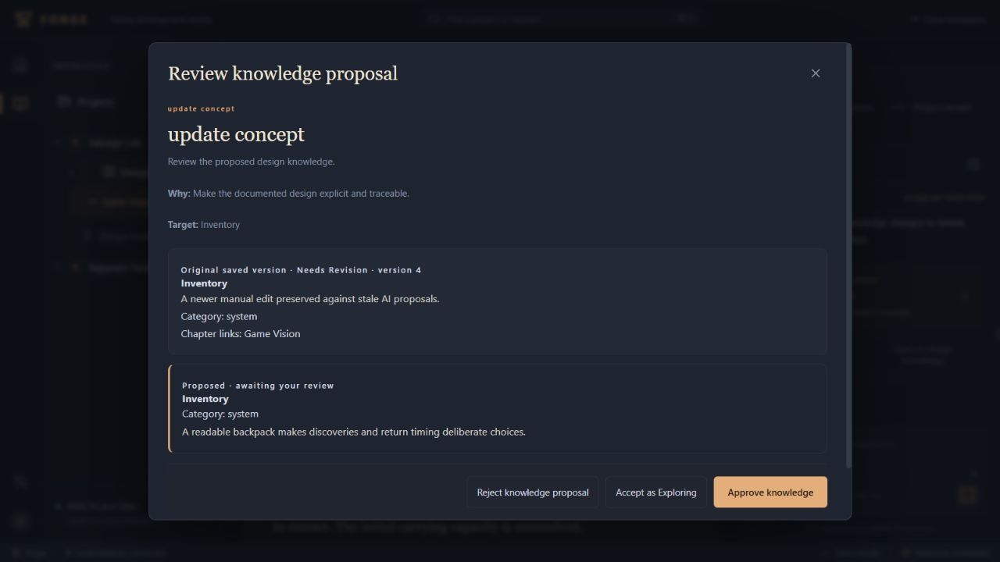

# Goal 3 — Milestone 4: AI Knowledge Integration

Date: 2026-10-11. Milestone 3's existing working-tree changes were retained. This milestone connects the existing chapter Workshop to existing structured knowledge through explicit human review. It stops here for review; no Milestone 5 implementation was started.

## 1. Implementation summary

The Workshop now has **Design together → Extract Design Knowledge**, and ordinary conversations can propose knowledge changes. The existing backend OpenAI Chat Completions adapter, streamed replies, persisted conversations, pending/accepted/rejected proposals and transactional review remain in use.

Supported actions: create/update concepts; set their chapter associations; create/update/retire relationships; record concept-linked decisions and questions; supersede decisions; resolve questions with a proposed answer. Every action is a validated pending proposal. No extraction runs automatically or in the background, and conversation never directly mutates knowledge.

Reviews show action, target, saved original content, proposed fields, reason, related chapters/concepts, source chapter revision, resulting authority choices and prerequisites. Controls remain visible while scrolling long previews. Rejected/stale proposals preserve newer knowledge. Accepted cards link into Design Knowledge: concepts directly; relationships through their endpoint detail; decisions/questions through the matching record workspace with the resulting record highlighted.

Structured context provides relevant concept IDs/revisions, chapter associations, typed relationships with authority state, and associated decisions/questions. Current approved decisions are distinguished from relevant superseded history. Concepts are ranked using chapter links, name relevance and authority; retrieval follows one bounded relationship hop. Full current instructions are preserved within the existing API input limit. This is an incremental context extension, not the later retrieval redesign.



## 2. Schema and API changes

Additive migration **6**, after migration 5:

| Storage | Purpose |
| --- | --- |
| `proposals.knowledge_payload` | Backend-generated versioned operation metadata, original target snapshot, expected reference revisions, readable labels, source chapter/revision and dependency references |
| `proposals.applied_result` | Result entity type/ID/revision and explicit review outcome |
| `proposal_dependencies` | Proposal → prerequisite proposal references and unique temporary concept keys; FK/self-reference and same-project/same-response guards |

Triggers prohibit changing proposal metadata or replacing an already persisted result. Migration is transactional and repeatable, with rollback on failure. Existing projects, chapter JSON/approvals/history, knowledge, conversations and legacy pending proposals retain their IDs/content/status. No second knowledge model or document store was introduced.

Existing `POST /api/chapters/:id/chat` accepts workflow `extract`. Existing `POST /api/proposals/:id/review` gains optional `outcome: exploring | approve | accept` for knowledge proposals; inappropriate or missing outcomes are rejected. Existing document proposal payloads and review behavior remain compatible. Workshop responses expose proposal metadata and accepted result references. Existing knowledge read/mutation endpoints remain unchanged.

Modules: `shared/knowledge-proposals.ts`, `server/proposal-migration.ts`, `server/knowledge-output-schema.ts`, `server/knowledge-proposals.ts`, with wiring in `db.ts`, `store.ts`, `app.ts`, `ai.ts` and `context.ts`. KnowledgeStore adds a scoped accepted-proposal evidence path, validating conversation/message/project and the exact source revision before recording evidence. It invokes the existing domain operations and authority checks.

## 3. AI proposal contract

New envelope: `kind: knowledge`, title, reason, description and a strict `knowledge` payload with `version: 1` and a discriminated action. Legacy envelope chapter fields are null/empty for this variant. Unknown fields, invalid types, unsupported versions and model-supplied authority/ownership/source/result fields are rejected.

| Action | Required operation data |
| --- | --- |
| `create_concept` | Unique short key, name, category, description, chapter IDs |
| `update_concept` | Existing target ID/revision and proposed name/category/description |
| `associate_concept` | Existing target ID/revision and complete resulting chapter-link set |
| `create_relationship` | Source/target concept references, type and rationale |
| `update_relationship` | Existing relationship ID/revision, proposed endpoints/type/rationale |
| `retire_relationship` | Existing relationship ID/revision |
| `record_decision`, `record_question` | Statement, rationale, chapter IDs and concept references |
| `supersede_decision` | Existing current decision ID/revision and replacement statement/rationale/links |
| `resolve_question` | Existing open question ID/revision and proposed answer |

Concept references are either `{id: existing UUID}` or `{newConcept: key}` referring to a creation proposal in the same response. The backend allocates actual proposal/entity IDs. Up to ten proposals are permitted per completed response. The provider's strict JSON schema uses explicit alternatives; shared Zod validation and domain validation still run after generation.

The model prompt favors meaningful subjects, reuse of existing concepts, supported choices and significant uncertainties. It identifies pending proposals and speculative relationships as unapproved, respects current approved decisions, and does not invent historical authority. Exact normalized-name and relationship duplicates are rejected; semantic similarity is guidance for the model rather than automatic merging.

## 4. Review and dependency behavior

- Concepts and relationships: **Accept as Exploring** stores unreviewed knowledge; **Approve knowledge** applies and approves the resulting exact version in the same transaction. Previous approvals remain in history.
- Decisions/supersession: **Approve decision** is required. Supersession creates a replacement and preserves the old statement, rationale and sources.
- Questions: **Accept open question** records unresolved information. **Accept resolution** records its answer and resolution without creating a decision.
- Retirement: explicit **Retire relationship** retains evidence and removes current authority.
- **Reject knowledge proposal** changes only review state and leaves knowledge/chapter prose unchanged.

Dependencies are shown on cards and reviews. Each prerequisite must be accepted individually, and acceptance may be Exploring or Approved. A dependent relationship/record remains blocked if its prerequisite is pending, rejected, missing, archived or changed after acceptance. No dependency is silently accepted. New-concept references cannot point to another response/project, unknown keys, duplicate keys or self relationships.

**Grouped acceptance is deferred**, as permitted by the milestone. A group would require another explicit review surface for selecting and validating per-entity authority outcomes. Individual review provides the complete required workflow with simpler, auditable controls; it does not substitute automatic prerequisite acceptance.

Original targets, existing referenced concepts, source chapter and relevant chapter links carry revision guards. Targets changed during generation keep their pre-request original snapshot but fail later acceptance. Changed/archived/foreign targets, duplicate names/edges and repeated review are rejected by the backend, even if a stale browser still offers a button. The UI checks current revisions before enabling acceptance and offers regeneration/rejection when stale. Network errors preserve the review; a committed review followed by refresh failure is reported as saved and is not automatically retried.

Acceptance, entity mutations/approval, immutable change/source evidence and applied-result persistence share one SQLite transaction. Evidence failures, approval failures or result-write failures roll back all changes and leave the proposal pending. Provenance includes the actual conversation, complete assistant message, accepted proposal and exact source chapter revision, classified as a proposal action rather than manual entry.

## 5. Verification results

### Automated checks

Exact commands:

```powershell
npm run check
& 'C:\Users\garne\.cache\codex-runtimes\codex-primary-runtime\dependencies\node\bin\node.exe' --import tsx --test --test-isolation=none tests/*.test.ts
npm run build
git diff --check
```

Final results: **TypeScript passed; 95 tests passed, 0 failed/cancelled/skipped/todo; production build passed; whitespace check passed**. Runtime tests used bundled Node 24.19.0. The build retains the existing large-chunk warning: JS 800.29 kB, gzip 241.78 kB; CSS 40.59 kB, gzip 9.17 kB.

There are fourteen new tests in `tests/knowledge-proposals.test.ts` and two new React frontend/integration tests in `tests/knowledge-ui.test.ts`, with all 79 Milestone 3 regression tests still passing. The existing document-proposal test helper's type was narrowed to its legacy variant after introducing the discriminated knowledge variant; its runtime scenarios were preserved.

Coverage includes all ten operation types; explicit outcomes; decisions/questions and historical evidence; duplicate names/edges/records; pending/rejected/unknown/changed prerequisites; stale target and source revisions; project ownership and archived targets; rejection without mutation; exactly-once review; evidence, approval and result-persistence rollback; immutable proposal snapshots; version-5 migration preservation/failure rollback/retry; database reopening; streamed extraction → review → retrieval into the next conversation; speculative/historical authority labels; and full current instructions.

React tests use actual components, Fastify routes and disposable SQLite through the existing JSDOM harness. They exercise extraction, blocked dependency buttons, individual Exploring/Approved choices, decision approval, rejection, accepted result navigation and stale original/proposed previews. A provider transport fixture invokes the actual OpenAI adapter and validates its outgoing strict schema and streamed typed-response parsing. Deterministic tests never make a paid provider call.

### Actual browser workflows

The built app ran in the actual browser against a separate disposable SQLite database/server on port 4311. The preview did not load `.env` or production data. Its deterministic assistant used the actual SSE/generation/review/persistence path.

Verified:

1. Extract Design Knowledge generates five pending concept/relationship/decision/question cards, with no automatic entities or chapter edits.
2. Relationship review shows Inventory/Extraction prerequisites pending and disables acceptance.
3. Accept Inventory as Exploring and Extraction as Approved individually; relationship review becomes enabled and labels both outcomes. Approve its directed effect with rationale.
4. Explicit decision approval and question acceptance create linked knowledge; accepted-result links open the workspace. Original source inspection displays the accepted proposal, actual Workshop response and exact saved chapter version.
5. Natural messages propose an existing concept refinement, decision supersession and question resolution. Reviews show original/proposed statements and the proposed answer. Approved replacements and resolved answers appear in Design Knowledge.
6. Reject a retirement proposal; its relationship remains Approved. Later explicitly accept another retirement proposal.
7. Generate a concept update, save a newer manual edit, reopen review, and observe stale warning plus disabled acceptance. Rejection preserves the newer edit and earlier approved version.
8. Historical decision toggle exposes the original superseded statement with its replacement. Switching to Separate Garden displays only Seasonal Growth and no Salvage Lab knowledge.
9. Stop/restart the same preview server/database, reload the browser, and recover accepted/rejected review records, result navigation, resolved answer, newer unreviewed concept/last approval, relationship and decision states. A later final-build reload also preserves those results.
10. Visually inspect the readable original/proposed review and persistent controls at 1280×720. Browser warning/error logs were empty.

Existing Design Book remains present and its prose unchanged by all accepted knowledge operations. The complete regression suite covers editing, rich documents, hierarchy, original Workshop chapter proposals, revision review and persistence. This milestone's browser did not separately repeat every earlier chapter-operation workflow or test a mobile viewport.

### Live OpenAI check

A separate in-memory game fixture invoked the actual OpenAI Chat Completions adapter with the existing configured key/model, without production project content. Restricted execution initially failed to connect; the authorized network-enabled retry succeeded.

The configured model **gpt-6.1-sol** returned **five backend-validated proposals**: three concepts, one relationship and one question. The backend persisted their reviewable proposals; **zero knowledge entities were created automatically**. The probe printed only model/action/count metadata, never credentials, request bodies or provider prose. Real-provider generation/transport/schema compatibility was exercised; the extensive acceptance/rollback/browser cases use deterministic output for repeatability. This is one live response, not a broad assessment of model design quality or every model's compatibility.

Temporary preview/probe scripts, databases and SQLite sidecars were removed after checks. The user's production database was not opened for verification.

## 6. Known risks and deferred functionality

- Individual dependency review is complete; atomic grouped acceptance remains deferred. A prerequisite changed after acceptance requires regeneration of its dependent proposals.
- Exact duplicate detection is enforced; semantic near-duplicates rely on model reuse and human review. No automatic merge or background synchronization was introduced.
- Structured context remains bounded and heuristic. Significant omissions use the existing truncated flag; a full context manifest, project-wide outline, sophisticated retrieval and performance measurements remain later work. Historical source metadata is available through the UI; the model receives entity authority/history state, not complete source histories.
- Document AI proposals retain their existing Markdown-to-editor/text-diff behavior. Canonical rich-document generation/review fidelity remains a later milestone; knowledge proposals do not alter document prose.
- Migration on the user's actual database, mobile browser layout and all provider/model combinations were not exercised. Disposable legacy fixtures and one configured live model were tested.
- The existing Vite bundle warning and previously reported `@fastify/static` dependency audit finding remain outside this milestone's scope. No unrelated major dependency upgrade or application shell redesign was made.
- Accepted result links are historical creation/application references. They show the outcome at acceptance; later manual changes are shown by the resulting entity's current detail/history. Retired relationships are inspectable from the endpoint detail's historical toggle.

## 7. Milestone 5 recommendations and completion audit

Prioritize rich-document fidelity: one editor-supported canonical JSON schema for AI document changes, meaningful rich before/after previews, preserved headings/lists/links/marks, and adversarial round-trip/section-update verification. Then extend context observability and retrieval: source/omission manifests, clear historical evidence, bounded relationship traversal and measured large-project performance. Keep human review and current transactional/revision safeguards intact.

| Completion requirement | Evidence |
| --- | --- |
| 1–4: concepts, refinements, relationships, decisions/questions from conversation | All ten typed operations; actual SSE integration tests; live validated extraction; browser steps 1–5 |
| 5: safe existing/new references | Strict references, same-response dependency table, captured revision guards; invalid/rejected/changed/foreign dependency tests; browser blocked/enabled reviews |
| 6–7: individual review and explicit authority | React review controls and tests; Exploring/Approved choices; decision-only approval; browser steps 2–7 |
| 8–9: persistence and workspace inspection | Atomic KnowledgeStore application/result references; backend retrieval/reopen tests; browser source/detail navigation and process restart |
| 10: provenance, history, isolation | Backend-generated evidence and immutable snapshots; rollback/ownership/migration tests; browser original sources, supersession, stale review and separate project |
| 11: existing Design Book/Workshop | All 79 prior tests pass; unchanged editor/transport and preserved prose in frontend/browser knowledge workflow |
| Required checks, actual browser and secure real integration | 95 tests, TypeScript/build, disposable actual browser, one live OpenAI generation as described above |
| Required report and stop gate | Seven sections above; no Milestone 5 work, autonomous extraction, new agents or excluded studio subsystems |

Milestone 4 is complete and stops here for review.
