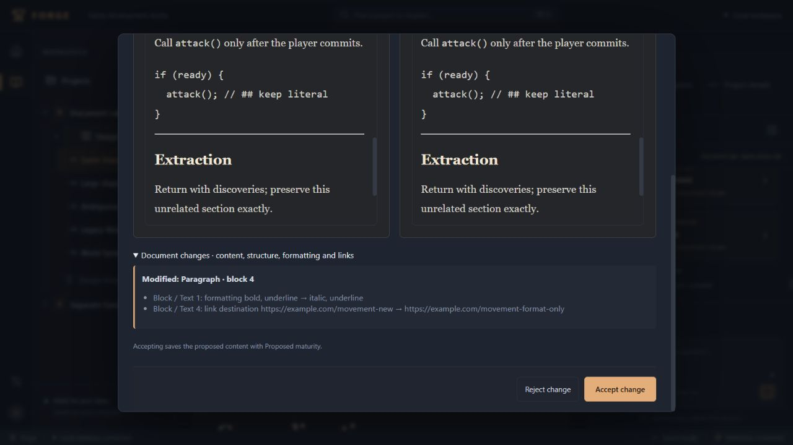

# Goal 3 — Milestone 5: Document integrity and AI editing fidelity

Completed October 11, 2026. Scope ends at Milestone 5; Milestone 6 awaits review.

## 1. Implemented changes

Design Book editing, AI context, proposal validation, review, and acceptance now use the same canonical rich-document structure. New AI document changes no longer pass through plain text or Markdown reconstruction. The server materializes section edits from the exact saved source, preserves unrelated nodes, and refuses full replacement when the supplied context is incomplete.

Rich original/proposed previews and a structural difference summary expose text, heading, list, formatting, and link changes. Existing approval, history, stale revision, project ownership, transaction, conversation, and knowledge workflows remain in place. Opening an editor no longer converts Markdown automatically or inserts a trailing paragraph. Unsupported saved structures are retained and disclosed through a read-only source guard instead of being silently normalized or crashing the preview.

Migration 7 adds nullable document proposal metadata and immutability protections. It does not rewrite existing chapters, snapshots, approvals, conversations, or legacy proposal content. The user approved this compatibility approach and explicitly requested retention of safe stored legacy creation and section proposals. No production database was used for verification.

## 2. Canonical document and AI operation contracts

`shared/document.ts` validates JSON against the actual Tiptap schema built from the same extensions used by the editor and previews. Supported content includes headings 1–6, paragraphs, hard breaks, bullet and ordered lists with nested list items, quotes, code blocks, horizontal rules, and text with bold, italic, underline, strike, code, and link marks. Ordered-list starts/types, code languages, and supported link attributes are retained. Unknown nodes, marks, fields, attributes, invalid nesting, incompatible marks, invalid link destinations, excessive depth, and excessive size are rejected. Validation returns the submitted representation without serializing schema defaults back into it. Limits are 500,000 JSON characters and depth 20; links use the existing HTTP, HTTPS, and mailto policy.

New provider responses use `kind: "document"`, target/parent/title/description/reason fields, and a discriminated `document` payload with `version: 2`:

| Action | Rich payload | Enforcement |
| --- | --- | --- |
| `create_chapter` | Complete `document` | Canonical validation and project ownership |
| `create_subchapter` | Complete `document` | Same validation plus valid parent placement |
| `update_chapter` | Complete `document` | Complete source coverage and revision match |
| `add_section` | `heading`, `level`, rich block `body` | Preserves existing blocks; rejects duplicate target headings and invalid hierarchy |
| `revise_section` | Exact `heading`, rich block `body` | Requires unique top-level heading and complete supplied section; preserves heading and all outside nodes |

A section ends at the next top-level heading of equal or higher rank; subordinate headings belong to its body. Missing/ambiguous selectors and body headings that escape the selected scope are rejected. Empty section bodies are supported without applying a placeholder paragraph.

Context consists of whole canonical blocks, preserving marks, links, nesting, and code. Backend-generated receipts record complete-document coverage, included block indexes, and completely supplied sections. The model cannot authorize its own coverage, ownership, source revision, or approval. These receipts are narrow integrity metadata, not a retrieval redesign. The current active-document budget is 10,000 JSON characters. A source revision and receipt are captured before generation and stored with the proposal. Storage normalizes the envelope into the existing operation kind while retaining immutable V2 metadata and exact rich proposed content.

The provider-specific recursive strict JSON schema lives separately in `server/document-output-schema.ts`. Newly generated legacy text document operations are rejected at the API boundary. Acceptance recomputes the materialized result and reuses atomic revision checks, history, and provenance. Accepted content is Proposed; approving the saved chapter version remains a separate explicit action.

## 3. Before/after review behavior

Previously, flattened text comparisons hid formatting-only and destination-only changes. New review renders both documents through the shared read-only Tiptap preview. The difference summary identifies heading levels, list structure and starts, node types, nested text, marks, and link destinations. It also reports added and removed blocks. Source version, coverage, stale state, legacy compatibility, and resulting maturity are visible; acceptance/rejection controls remain reachable in the sticky footer.

The final browser fixture changed bold to italic and changed a link destination while preserving identical visible words in both previews. Both changes appeared in the summary; rejection preserved the saved document. Separate browser runs accepted rich localized and full formatting changes and immediately showed the resulting formatting, links, code, and unrelated sections in the editor.

## 4. Legacy compatibility handling

Stored legacy proposals are classified using their saved rich content and original snapshot. Safe creations and safe localized section changes remain individually reviewable and accept their stored content exactly. Localized compatibility requires exact preservation outside a unique target range and valid hierarchy. Unsafe section changes and all legacy full replacements are blocked and offer regeneration; they are never silently reinterpreted as V2 operations.

Regeneration carries the intended operation and affected section into a new request using the current saved source. It does not modify the old proposal or apply a change automatically. Historical accepted proposals and chapter versions remain unchanged. Invalid/unsupported historical content remains accessible as retained JSON with an explicit explanation; editing requires a supported restoration or reviewed replacement. Literal Markdown in otherwise supported saved paragraphs remains literal until deliberately edited.

## 5. Test and browser verification

Final checks: **117 tests passed**, TypeScript passed, production build passed, and whitespace validation passed. Tests use supported Node 24.19.0. The final production bundle is 810.39 kB JavaScript (245.00 kB gzip) and 41.39 kB CSS (9.32 kB gzip). Existing large-chunk guidance remains a build warning.

New coverage includes 14 document-integrity tests, 3 structural-diff tests, and 5 frontend workflow/compatibility tests, alongside 95 existing regressions. Old generation fixtures explicitly emit V2 rich operations; legacy migration assertions intentionally expect full-replacement regeneration. Coverage includes actual-schema validation, exact round trips, malformed/adversarial trees and links, all document action types, unrelated-node preservation, same-words formatting/link changes, missing/ambiguous headings, partial context, stale revisions, rejection, immutable metadata, rollback, project isolation, history/approval/restoration, database reopen, and migration rollback/retry/repeatability from a real version-6 table shape.

Integration tests exercise conversation → SSE proposal → rich review → acceptance → saved document and approved history. Frontend tests also verify safe legacy review, unsafe legacy blocking, section-preserving regeneration against the newest source, unsupported historical previews, and unsupported current chapter retention without autosave.

Deterministic transport fixtures exercise the actual OpenAI adapter, recursive output schema, and rich JSON response validation. One small live smoke test using the configured `gpt-6.1-sol` model produced a valid canonical `revise_section` proposal with complete source coverage. Unrelated nodes and the original source were unchanged. It used only synthetic in-memory document data, exposed no credentials, and did not apply its proposal. This is a contract smoke test, not a general model-quality evaluation.

Actual browser QA used an isolated SQLite database and deterministic assistant on port 4311. Verified:

- Rich section review/acceptance with nested headings, list changes, formatting, links, code, and preserved Combat/Extraction content.
- Formatting-only full replacement review, rejection, and explicit acceptance; identical text did not hide changed marks or URLs.
- Last-approved comparison and restoration into a new unreviewed revision, preserving all prior history.
- Manual edits making a proposal stale, disabled acceptance, rejection preserving newer work, and localized regeneration using the latest source.
- A partial-context chapter rejecting full replacement while accepting the completely supplied Movement section and preserving 20,833 characters of unrelated World detail.
- Duplicate headings producing a validation error without changes.
- Safe stored legacy section/creation acceptance and blocked legacy full replacement.
- Canonical section addition and new chapter creation with rich content.
- Design Knowledge extraction/acceptance, result navigation, and isolation between two projects.
- Restart recovery of rich content, maturity, accepted/rejected proposals, approved history, and Workshop conversation. Final recovered source was version 10; its Progression section, link destination, code, and approved-version marker remained intact.

Final browser console warning/error inspection returned no entries. Temporary scripts, preview server, and disposable database were removed after verification; the user's server and data were not replaced.

### Completion audit

| Required outcome | Evidence |
| --- | --- |
| Rich AI structure preserved | Actual-schema tests, adapter tests, accepted rich browser documents |
| Localized edits cannot change unrelated sections | Server materialization, exact-node assertions, large browser chapter |
| Full replacements require complete source | Coverage validation and partial-context API/browser rejection |
| Actual rich differences inspectable | Shared previews, structural tests, identical-text browser review |
| Correct history and provenance | Transaction tests, exact saved revisions, knowledge extraction/source regressions |
| Approved versions recoverable | Automated restoration and browser approved-version restore |
| Explicit legacy handling | User-approved policy, safe/unsafe compatibility tests and browser reviews |
| Knowledge and conversations functional | Existing regressions, browser extraction/navigation and restart recovery |
| Complete editing workflow verified | Frontend, SSE, transport, live smoke, and disposable browser workflows |
| Existing projects/documents intact | Additive migration preservation tests; no production data writes |

## 6. Known limitations and remaining risks

Section selection currently uses unique top-level heading text rather than stable section IDs. A section whose complete JSON cannot fit the context budget requires a smaller edit, manual editing, or clarification. Full replacement allows an explicitly reviewed whole-document change; it does not promise preservation inside that approved replacement. Unsupported legacy structures cannot be silently made editable.

The difference summary operates on blocks and nested structure, with bounded LCS work and a positional fallback for very large comparisons. It shows up to twelve details per changed block and directs the reviewer to complete rich previews for additional changes; it is not inline word-level tracked changes. Rich panels scroll independently. Desktop primary flows were verified; broad mobile/device coverage and every provider/model were not verified.

The existing Vite chunk warning and pre-existing high-severity `@fastify/static` dependency audit finding were not expanded into unrelated dependency work. Concurrent edits continue to use optimistic rejection rather than merging. No production database was inspected or migrated during QA; startup applies the tested additive migration to the user's database normally.

## 7. Recommendations for Milestone 6

Retain V2 rich contracts and backend coverage enforcement while improving source selection and explainable retrieval. Build on immutable source revisions and the narrow coverage receipt so context selection can be audited without implying authority for exploratory or historical material. Consider stable section identifiers only with an explicit migration and compatibility plan. Continue adversarial preservation tests around omitted/large sources, approved direction, links, and formatting.

Do not broaden retrieval, introduce semantic/vector infrastructure, or start Milestone 6 before this milestone is reviewed.
