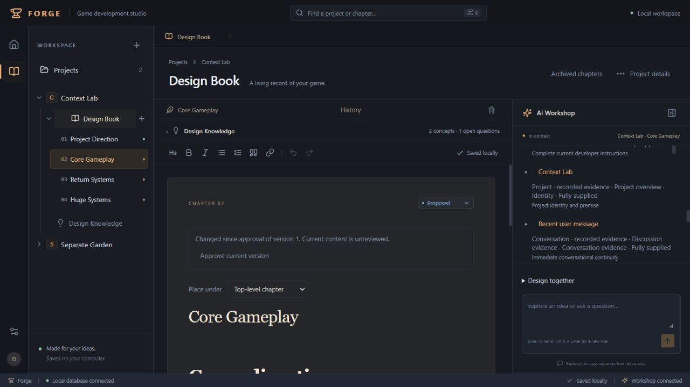
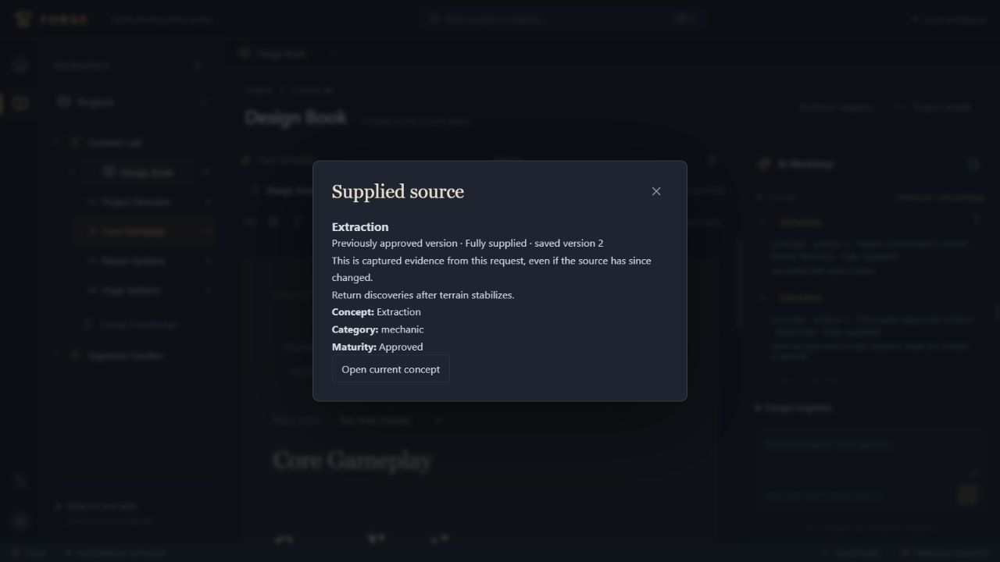
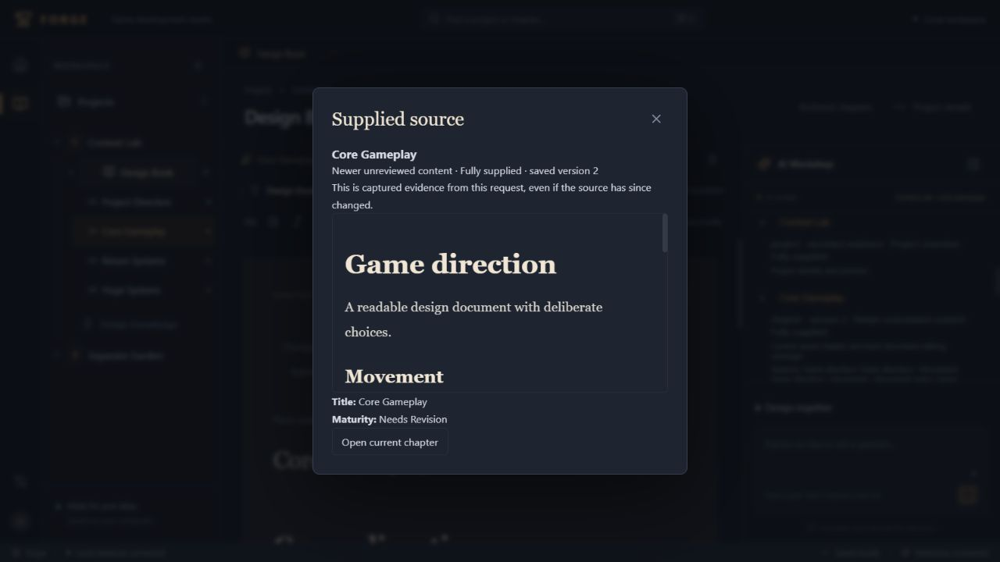

# Goal 3 — Milestone 6: Context intelligence and knowledge retrieval

Completed October 11, 2026 (America/Chicago). The developer approved the architecture with refinements covering transparency, configurable byte/model budgets, recent continuity, exact request integrity, recovery/storage costs, explicit Game Vision correction, and adversarial verification. Scope ends at Milestone 6; Milestone 7 awaits review.

## 1. Architecture and retrieval summary

The existing chapter-scoped Workshop now retrieves an interconnected project corpus through a centralized service. It reads normalized concept/chapter and record associations in bulk, ranks current and recent conversational topics, discovers related subjects through documented relationships, selects relevant canonical sections beyond the active chapter, and resolves exact approved/historical evidence. A compact project outline supplies names, categories, maturity, chapter hierarchy/section headings, relationship endpoints/types, current decisions, and outstanding questions without sending every chapter body.

Responsibilities are separated across `server/context.ts` (selection/orchestration), `context-retrieval.ts` (corpus reads, lexical matching, sections and graph traversal), `context-budget.ts` (serialized limits and token/headroom checks), `provider-format.ts` (provider body construction), and `context-store.ts` (immutable capture and scoped inspection). The existing React, Fastify, SQLite, OpenAI/SSE, document V2, knowledge V1, chapter history, and human-review paths remain in place. No vectors, agents, graph interface, summaries, Unity, or production-management features were introduced.

New provider requests keep invariant instructions in the system message and retrieved project material in a separate labeled source-data message. Recent exchanges retain their complete conversation content; relevant earlier discussion is labeled source evidence. The current developer message remains intact and last in the conversational sequence. Role-like strings inside project text cannot change the JSON message roles or backend authority labels. Server validation and explicit review still enforce changes independently of model behavior.

## 2. Context selection and authority rules

Current message references, exact concept/chapter names and IDs, the recent conversational subject, active-chapter associations, full section text, documented edges, and explicit historical-state queries determine selection. Unicode normalization and lexical matching approximate relevance; this is not semantic/vector search. Ties use stable IDs. Short follow-ups retain the subject of the recent exchange instead of relying solely on words in the new message.

Relationship traversal is breadth-first, cycle-safe and bounded to two hops, forty concepts, and sixty edges. Relevance-ranked seeds retain priority. Incoming/outgoing direction is explicit for directed edges; symmetric edges remain symmetric. Traversal never creates relationships. Limits and omitted neighbors are disclosed.

Relevant current approved unsuperseded decisions receive priority. Relevant unresolved questions have reserved slots rather than being displaced by all decisions. Exact approved chapter, concept, and relationship snapshots remain separate from newer live changes. Authority labels distinguish current approval, previous approval, unreviewed changes, exploration, archived/retired/superseded evidence, resolved answers, unresolved questions, and discussion. Historical-state queries can discover archived concepts, retired edges, superseded decisions, and resolved questions even without naming a specific subject. Relevant knowledge provenance can supply original saved chapter revisions and original discussion evidence.

Section indexing retains heading hierarchy, paths, block ranges, chapter ID, and exact revision. Retrieval prefers whole relevant rich ranges, deduplicates overlap, preserves marks/links/code/lists, and never cuts text or JSON inside a document node. Partial sources are labeled. The active chapter receives a dynamically budgeted source allocation; larger complete documents can be supplied when they fit. The final Milestone 5 receipt describes the actual current source supplied after selection. Historical evidence cannot authorize editing another chapter or substituting an older revision for the current edit source. Missing/ambiguous heading and incomplete-source guards remain enforced.

Current instructions support 20,000 characters. Oversized input is explicitly rejected; the frontend retains it in the composer, and the backend does not trim supported instructions. Recent complete exchange receives capacity before project details. Concept/relationship/record/chapter category reservations protect other relevant material and discovery/history capacity. Overview entries are references rather than full detail; long record statements use an explicit detail-required placeholder instead of a misleading truncated directive.

Starting limits are configurable: 128 KiB serialized context and 192 KiB complete provider JSON body. The body measurement includes source metadata, conversation, instructions, output schema, and JSON framing. Token checks reserve configured output headroom (default 8,192 tokens). Recognized GPT-4.1 encodings use `o200k_base`, a full-body estimate, a 15% safety margin and 1,024-token reserve. Unknown encodings and long unbroken text use a conservative UTF-8 byte bound plus framing reserve. The latter also prevents adversarial text from causing quadratic JavaScript tokenizer work.

The recognized GPT-4.1 family profile has a 1,047,576-token window and 32,768-token output maximum, as documented in [official OpenAI model documentation](https://developers.openai.com/api/docs/models/gpt-4.1-mini). The configured GPT-6.1 Sol profile has a 1,050,000-token window and 128,000-token output maximum, verified against [its official model page](https://developers.openai.com/api/docs/models/gpt-6.1-sol). Sol retains a conservative byte token bound until an encoding is verified. Known profiles reject settings above verified context/output maxima. For unrecognized models, the 32,768-token application ceiling is conservative configuration, not a certification of supported capacity. Verify the provider's capacity and configure `FORGE_MODEL_CONTEXT_TOKENS`; select `FORGE_TOKENIZER` only with a verified encoding. Invalid or impossible budgets return an actionable 422 error rather than dropping current instructions. Unknown-model byte bounds can considerably reduce supplied context.

## 3. Context manifest and UI behavior

Every dispatched attempt captures its finalized context, manifest, provider-ready JSON body, separate SHA-256 context/body digests, and `forge-chat-context-v1` format identifier before dispatch. The adapter reconstructs/verifies equivalence, checks configured limits, and sends that exact serialized body. It never independently trims selected sources. Body integrity includes messages, instructions, model/output settings, schema, and framing; it excludes transport headers and credentials. A context-only digest is not presented as proof of the entire body.

Manifests record source IDs and revisions, authority/maturity, complete/partial/overview coverage, section paths/ranges, reasons, relevant omissions/selection limits, measured sizes, token method, and retrieval time. They reflect the request rather than reconstructing later project state. Assistant responses link to their request. Legacy responses disclose that context was not recorded.

**Context Used** is an on-demand disclosure inside each assistant response. It explains that these are supplied sources, not proof of what the model considered, and that authority/versions reflect the request time. The first twelve source entries and six omission entries keep the conversation compact; additional entries expand. Source inspection renders captured rich documents or readable knowledge/discussion fields and offers navigation to current chapters/concepts through existing save-flush guards. Later source edits do not change captured content. Failed/interrupted attempts clearly distinguish recorded prepared context from unconfirmed delivery or success. Read failures offer retry.

## 4. Data model and API changes

Additive, transactional, repeatable migration 8 introduces:

| Table | Purpose and constraints |
| --- | --- |
| `project_context_anchors` | Stable project-owned Game Vision chapter and origin; insert/update ownership triggers |
| `workshop_context_requests` | Immutable project/chapter/user-message-owned context, manifest, exact body, digests, format and time |
| `workshop_response_contexts` | Immutable, unique assistant-response/request association with conversation ownership checks |

New projects anchor their initial chapter. Legacy backfill requires unique historical creation evidence; ambiguous or unreliable evidence stays unassigned and is disclosed. Renaming never changes the association. Archival retains the reference and discloses unavailable current context. Project details allows deliberate correction or removal without changing chapter content or approval.

Project-scoped APIs:

- `GET/PATCH /api/projects/:id/context-anchor` inspect/change the association.
- `GET /api/projects/:id/context/:requestId` returns the manifest and capture metadata.
- `GET /api/projects/:id/context/:requestId/source?key=...` returns only the selected captured source through a readable typed view.
- Workshop reads include a lightweight request reference on recorded assistant messages; full manifests load separately.

Inspection checks ownership and stored body/context digests. It does not expose authorization headers, environment dictionaries, credentials, or unrestricted raw provider payloads. Snapshot tables and associations reject mutation/deletion through ordinary SQL. Existing chapters, approvals, knowledge, messages, and proposals are not rewritten. Requests that reached capture survive failure/interruption. Startup recovers orphaned attempts with an explicitly interrupted message exactly once, preserving evidence without inventing success or proposals. Pre-dispatch budget failures preserve the developer message and do not lock later requests.

## 5. Performance observations and storage cost

The reproducible command is `node --import tsx scripts/measure-context.ts` using Node 24.19.0. It uses only synthetic in-memory SQLite fixtures and writes [the measured results](MILESTONE_6_CONTEXT_MEASUREMENTS.json). Fixtures contain respectively 10/100/300 chapters, 32/302/1,502 concepts including seeded subjects, 60/900/4,500 regional relationship attempts plus the seeded edge, and 20/200/1,000 earlier messages plus seeded discussion. Actual inserted regional edges can be fewer because self/duplicate edges are rejected.

| Workload | Three retrieval runs (ms) | Provider body range (bytes) | Approximate snapshot text per request | Text for 1,000 similar requests |
| --- | --- | --- | --- | --- |
| Small | 467.21, 90.94, 85.64 | 151317-151332 | 320236-320272 bytes | 305.41 MiB |
| Medium | 267.92, 119.11, 107.98 | 158432-158451 | 339088-339131 bytes | 323.39 MiB |
| Large | 875.19, 194.12, 157.77 | 149151-149170 | 320823-320866 bytes | 305.98 MiB |

All nine runs retained the immediate exchange and retrieved all six seeded relevant sources: the existing Extraction and Terrain subjects, their edge, approved decision, remote rich chapter, and earlier discussion. Every body/context remained within configured byte/token/headroom limits. This is fixture coverage, not general semantic-retrieval accuracy. Timings are observations, not a production SLA; initialization, garbage collection, and background work affect first/warm runs. The performance test allows eight seconds for the representative large retrieval and asserts source coverage, continuity, byte limits, omission reporting, and snapshot cost.

Storage measures UTF-8 text for context, manifest and full body, excluding SQLite row/index/page/WAL overhead. Retaining both selected context and exact provider body intentionally duplicates material. It is meaningful local storage growth; no destructive automatic cleanup is introduced. A future user-directed export should include format/version metadata, manifests, hashes and scoped source evidence, with verification before any explicit archival/retention decision. Lossless storage deduplication/compression may be assessed separately while preserving exact request integrity and historical references.

## 6. Automated and browser verification

Final automated verification: **144 tests passed**, TypeScript passed, production build passed, and whitespace checks passed. New coverage comprises 22 retrieval/integrity tests, one representative performance test, and four frontend tests alongside 117 regressions. Existing synthetic tests were adapted to explicit relevance and measured limits; partial-source fixtures were enlarged because the new service can supply larger complete documents. Their original safety assertions remain: missing source prevents replacement, malformed/stale changes do not apply, and history/project isolation are retained.

Coverage includes project-wide discovery, exact names/IDs and recent follow-ups, directional/symmetric traversal, cycles/caps, full rich section hierarchy, UTF-8 section budgeting, larger configurable complete sources, approved/current versus prior/unreviewed snapshots, archived/retired/superseded/resolved state queries, provenance retrieval, complete maximum-length Unicode instructions, oversized rejection, recent continuity under large knowledge budgets, verified model/context/output maxima, manifest/body digest equivalence, actual adapter transmission without trimming, frozen coverage despite adapter mutation, pending suggestions and bounded hierarchy disclosures, cross-project inspection, immutability, failed/interrupted/orphan recovery, disk reopen, migration preservation/rollback/retry, source inspection after revisions, explicit anchors, frontend retry, and preserved oversized drafts.

The real OpenAI adapter is exercised through deterministic transport fixtures, including embedded prompt-injection strings outside system instructions and exact equality between the captured serialized body and `fetch` body. All existing knowledge/document proposal tests remain green. One small live smoke request using the configured `gpt-6.1-sol` connection completed with zero proposals and an unchanged synthetic book. Existing Extraction and approved direction were supplied; the response mentioned Extraction/terrain and discrepancy-related language. It retained the exact request snapshot, used 27,215 request bytes and a conservative 27,471-token input bound with 2,048 output tokens reserved, and exposed no credentials. Only synthetic in-memory data was sent; no production database was opened. This is a contract smoke check with basic text signals, not universal model resistance or a broad semantic/model-quality evaluation.

Actual browser QA used disposable synthetic projects/SQLite on port 4311. It verified:

- Beyond-active-chapter sources, current approved decisions, current unreviewed concepts, exact prior approved concept/relationship/chapter snapshots, questions, and relevant earlier discussion in Context Used.
- A short “Yes, how would that work?” follow-up retaining Extraction beyond a chapter without direct concept associations.
- Partial and omitted large-chapter coverage with explicit inclusion/omission explanations.
- Captured approved concept inspection followed by navigation to the live unreviewed concept.
- Canonical rich Movement review/acceptance, immediate editor refresh, preserved code/links/unrelated exploratory prose, and old captured source inspection after the current chapter changed.
- Explicit knowledge extraction, stale rejection, fresh acceptance as Exploring, and retained chapter-version provenance.
- Full replacement blocked for incomplete source, followed by a valid localized edit preserving **112,024 characters** of unrelated World detail.
- Response cancellation, explicitly interrupted state, retained prepared context, and restart recovery of accepted documents/knowledge/conversation/context without fabricated success.
- Explicit Game Vision correction, reread, and restoration without changing chapter content or maturity.
- Separate-project navigation showing only Seasonal Growth in the separate project's knowledge workspace.
- Final rebuilt client disclosure and current-source navigation; final console warning/error inspection returned no entries.

Temporary QA scripts/database/server are removed after verification. The user's production database and running server were not opened, migrated, or replaced during QA. Production startup applies the tested additive migration normally. The final build emits 816.94 kB JavaScript (246.92 kB gzip) and 41.85 kB CSS (9.41 kB gzip); the existing Vite chunk warning remains.

### Completion audit

| Required outcome | Direct evidence |
| --- | --- |
| Retrieve beyond current chapter | Remote rich chapter assertions, seeded coverage measurements, browser source inspection |
| Existing subjects/relationships influence discussion | Extraction reuse, directional graph tests, browser conversation/knowledge flow |
| Approved decisions prioritized | Authority/category selection assertions and actual browser approved-direction response |
| Historical/exploratory states distinguished | Exact snapshot and historical-state tests; captured/live concept inspection |
| Relevant canonical sections safely retrieved | Hierarchy/whole-node tests and partial-context browser edit preserving World |
| Current instructions never silently truncated | Maximum Unicode/transport equality, oversized composer/API rejection |
| Actual supplied sources disclosed | Persisted body/context hashes, adapter equality, Context Used/source inspection |
| Significant omissions visible | Budget/coverage/traversal assertions and actual incomplete-source disclosure |
| Knowledge/document proposals preserved | Full regression suite and browser rich/knowledge acceptance |
| Representative scale | 300-chapter/1,502-concept/4,500-edge/1,000-message fixture, measured cost/coverage |
| Complete experience validated | Frontend/API/transport/migration/recovery tests and disposable browser workflow |

## 7. Known limitations, deferred features and deviations

Lexical matching does not provide synonym understanding, embeddings, or a semantic oracle. Corpus reads/scoring still examine project material locally; representative fixtures do not prove performance for arbitrarily huge databases or long-term snapshot accumulation. Some graph neighbors/details are intentionally excluded; overview coverage does not imply full source coverage. Category reservations trade exhaustive graph detail for continuity, authoritative direction and document sections.

Token estimates include conservative reserves but are not a promise of exact provider accounting. Custom models need verified capacity/encoding configuration; otherwise conservative bounds can reduce context or fail clearly. One request can retain hundreds of kilobytes locally. Broad mobile/device coverage and comprehensive live model-quality/injection evaluations were not performed. Existing dependency audit and Vite chunk findings remain outside this milestone.

**Section identifier assessment:** permanent section IDs are not necessary to meet this milestone. Revision-specific heading paths and block ranges identify supplied evidence precisely, while unique-heading/current-revision edit guards prevent ambiguous changes. Duplicated headings still require clarification. Consider stable section IDs later only if practical cross-revision references or ambiguous editing demand them, with an explicit schema/history compatibility plan.

Refinements/deviations from the initial proposal: actual serialized provider bodies are retained and hashed separately from selected context; configured token capacity/output headroom augments bytes; recent exchanges and category reservations protect continuity/coverage; long unbroken text uses a predictable byte bound; document allocations scale with configured budgets and use UTF-8 bytes, allowing larger complete sources when they fit; historical-state/provenance queries and recent follow-up relevance were added during audit. Approved record selection precedes document allocation, and generation checks use coverage copied from the frozen request rather than an adapter's mutable working context. Defaulted heading attributes now index safely without rewriting canonical JSON. The disclosed UI bounds lists and retries reads. No destructive retention, summaries, manual context pinning, permanent section IDs, extra agent infrastructure, or Milestone 7 work was added.

## 8. Recommendations for Milestone 7

Review real usage and omission patterns before expanding retrieval. Add domain fixtures for terminology/synonyms, longer-lived projects, and genuinely large rich sections; retain exact request/authority tests as release gates. Verify capacities/encodings for any newly supported model. Assess lossless snapshot storage and user-directed export/retention using the measured costs before accumulating large workloads.

Use immutable manifests and source evidence to diagnose retrieval misses rather than silently broadening authority. Keep pending proposals, discussion, current exploration, and approved direction separate. Any future summaries must be derived evidence with original sources, not approval. Any permanent section identifiers or broader Workshop scope need an explicit compatibility review.

Stop here for Milestone 6 review; no Milestone 7 implementation is included.

